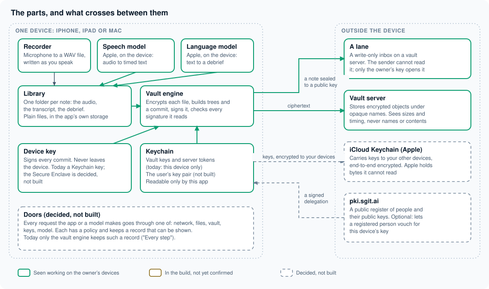
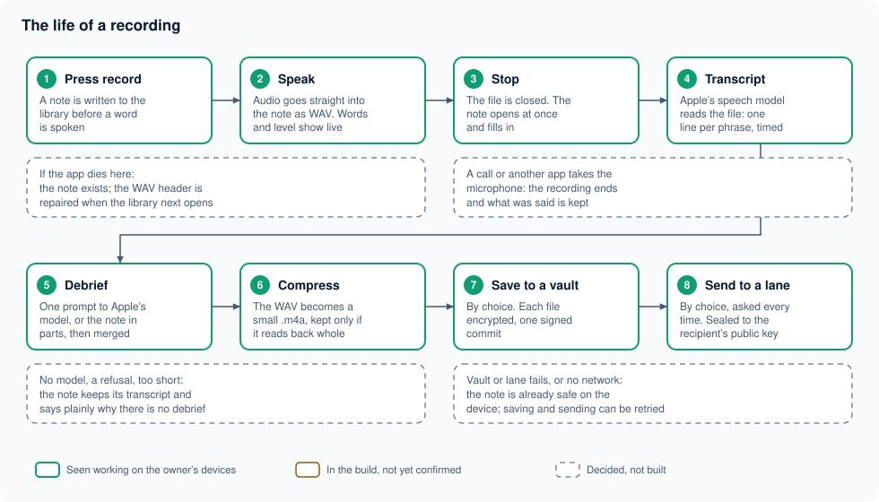
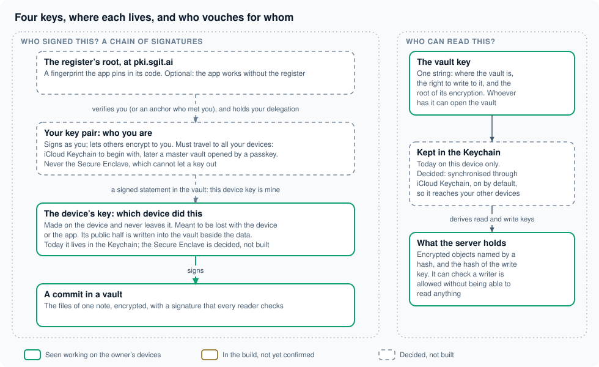
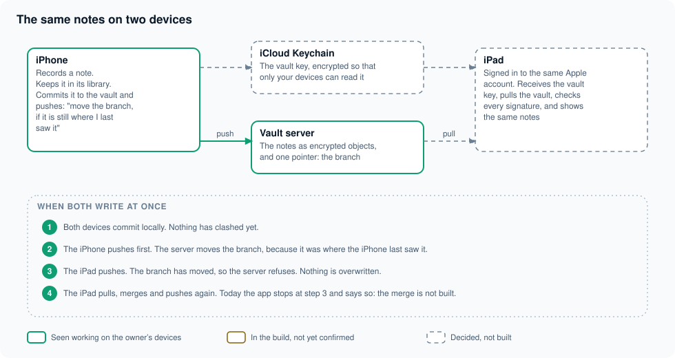

# How it works

The architecture of VoiceDebrief for iPhone and iPad in four drawings: the parts, the life of a recording, the keys, and two devices. Each drawing uses the same three marks, and the text under it says where the code is. A drawing opens at full size when it is pressed.

- A **green** outline: seen working on the owner's iPhone or Mac.
- An **amber** outline: in the current build, not yet confirmed on a device.
- A **dashed** outline: decided, not built.

This page explains; it does not certify. The record of what exists is [What is built](../built/index.md), and where the two disagree that page is right.

## The short version

1. The app records to a file inside a note that already exists, so a recording cannot be lost by anything that happens later.
2. Apple's speech model turns the file into timed text, and Apple's language model turns the text into a debrief. Both run on the device. No audio and no words go to a server for this.
3. The note is kept as plain files in the app's own storage. That is the library.
4. If you choose, the note is also written to a vault: every file encrypted on the device, one signed commit, pushed to a server that holds bytes it cannot read.
5. If you choose, and each time you are asked, the note is sealed to somebody's public key and dropped into a lane, which is a write-only inbox.
6. Keys decide everything. A vault key opens a vault. A device key says which device wrote a commit. A person's key pair says who they are, and vouches for their devices.

## 1. The parts

### On the device

| Part | What it does | Code |
|---|---|---|
| Recorder | The microphone to a 16 kHz, mono, 16-bit WAV file, written as you speak, with a level meter | `Engine/VoiceRecorder.swift` |
| Live text | A second listener on the microphone that shows words as they are heard. A preview only: the transcript that is kept is made from the file | `Engine/LiveTranscriber.swift` |
| Speech model | Apple's `SpeechAnalyzer` with a `SpeechTranscriber`: the recorded file in, one line per phrase out, each with its time | `Engine/SpeechFileTranscriber.swift` |
| Language model | Apple's Foundation Models framework: the transcript in, a debrief in three sections out | `Engine/OnDeviceModel.swift`, `Model/DebriefPrompt.swift`, `Model/Chunker.swift` |
| Library | One folder per note under Application Support: the audio and a JSON file with the transcript, the debrief and every step's timing | `Engine/NoteStore.swift`, `Model/Note.swift` |
| The conductor | The one object that owns the states: idle, recording, working, failed. It starts the recorder, runs the two models in order and writes each result into the note | `Engine/DebriefSession.swift` |
| Vault engine | Reads and writes sgit vaults: key derivation, encryption, trees, commits, signatures, and the calls to the server | `Packages/SGitVault/` |
| Vault book | The vaults this device knows: create one, add one by its key, list files and history, save a note into one | `Engine/VaultBook.swift` |
| Keychain | Where vault keys, the server token and the commit-signing key are kept, readable only by this app | `Engine/SecretStore.swift` |
| Lane sender | Seals a note to a public key and posts it to a lane | `Engine/DeveloperLane.swift`, `Engine/LaneCrypto.swift` |

The two models are Apple's, they are part of the operating system, and the app has no other. There is no API key in the app because there is nothing to call.

### Outside the device

| Part | What it holds | What it can see |
|---|---|---|
| A vault server (SG/Send) | Encrypted objects under names derived from a key it does not have, and one pointer per branch | Sizes, timing, and the address the request came from. Never file names, never contents |
| A lane | A list of sealed messages on a vault server | The same. The sender cannot read the lane back; only the holder of the private key can |
| iCloud Keychain (Apple) | Keys, encrypted between your own devices | Bytes Apple cannot read. Decided, not built |
| pki.sgit.ai | A public register of people and their public keys | Only public keys. Optional, and not built |

### Doors

The dashed box at the bottom of the drawing is a rule the code does not yet follow everywhere: every request that the app or a model makes should pass through one of a small number of doors (network, files, vault, keys, model), each with a policy and a record that can be shown on screen. Today only the vault engine keeps such a record, under "Every step" on a vault's screen. The reasoning is in [A harness inside the app](../articles/a-harness-inside-the-app/index.md).

## 2. The life of a recording

The order of these steps is the design. A recording is the one thing that cannot be made again, so it is put somewhere safe before anything clever is attempted.

1. **Press record.** `DebriefSession.startRecording` asks `NoteStore.begin` for a new note. The note's folder and its JSON file are on disk, marked as processing, before the microphone opens.
2. **Speak.** `VoiceRecorder.start(writingTo:)` writes WAV straight into the note's folder. WAV is used because its samples are usable even when the file was never closed; a compressed file cut off mid-way often is not. The live words and the level bars are drawn from a separate tap and can fail without touching the recording.
3. **Stop.** The file is closed and the note opens on screen at once, empty, and fills in as the next steps finish.
4. **Transcript.** `SpeechFileTranscriber` gives the whole file to `SpeechAnalyzer`. The model for the chosen language is downloaded the first time. The result is a list of lines with times, written into the note.
5. **Debrief.** If the transcript has fewer than 25 words there is nothing to summarise and the app says so. Otherwise `DebriefPrompt` builds one prompt and `OnDeviceModel.respond(to:)` asks it once. If the note is longer than the model's context (4,096 tokens on the devices tried), `Chunker` splits it, each part is summarised, and the parts are merged with one more call. The answer is checked for its three headings; an answer in the wrong shape is kept and flagged, not hidden.
6. **Compress.** This happens after the note is finished, never while recording. `AudioCompressor` writes an AAC `.m4a` beside the WAV, reads it back, and replaces the WAV only if the copy has the same length. A 16-second note is about 190 KB.
7. **Save to a vault**, by choice. Section 3 below.
8. **Send to a lane**, by choice, asked every time. Section 4 below.

### When something fails

| What happens | What you keep |
|---|---|
| The app is killed or the phone dies while recording | The note and the audio up to that moment. `WAVRepair` rewrites the file's header from its real length when the library next opens |
| A call, or another app, takes the microphone | The recording ends there and is processed as usual |
| No speech model for the language, or it fails | The note and its audio. It can be run again later |
| Apple Intelligence is off, the model refuses, or the note is too short | The note, its audio and its transcript, with a plain statement of why there is no debrief |
| The vault or the lane cannot be reached | Everything, on the device. Saving and sending can be tried again |

All eight steps have been seen working on the owner's devices, on the ordinary path. The failures in the table are covered by unit tests, including a cut-off WAV being repaired, but none has yet been provoked on a device: not the crash, not the interruption, not a recording with the screen locked.

## 3. A vault, from the inside

A vault is a version-controlled store, like a git repository, in which everything is encrypted before it leaves the device. The format is sgit's and is not ours to change; the app's engine is a Swift implementation of it, checked against sgit's own Python by CI.

### One string

A vault key is one string of two parts, `<passphrase>:<vault id>`. Everything else is worked out from it on the device:

| From the vault key | How | Used for |
|---|---|---|
| Read key | PBKDF2-HMAC-SHA256, 600,000 rounds, salted with the vault id | AES-256-GCM encryption of every object |
| Write key | The same, with a different salt | Proving to the server that this writer may change the vault. The server keeps only its hash |
| File names on the server | HMAC of the read key | So the server cannot tell which object is the branch, the index or a file |

So the server can check that a writer is allowed, and store what it is given, without being able to read a single name or byte.

### What saving a note writes

`VaultBook.save` turns one note into a folder, `debriefs/YYYY/MM/DD/<note id>/`, holding `debrief.md`, `transcript.md`, `run.json` and the audio (up to 3.8 MB today). Then the engine:

1. encrypts each file as an object named by the hash of its contents;
2. builds the trees that name those objects, each tree encrypted too;
3. writes a commit that points at the top tree and at the commit before it;
4. signs the commit with the device's key (ECDSA P-256);
5. sends everything in one batch, with the instruction "move the branch to this commit, if it is still where I last saw it".

That last condition is compare-and-swap, and it is what makes two writers safe: the second one is refused, not merged over. The first save from the app, on 13 November 2026, was 4 files, 12 objects and 192.5 KB, and was pulled back with its signature verified.

Reading is the same in reverse, and the engine verifies the signature of every commit it reads. The vault's screen shows the head, the files, the history and the traffic that produced them.

### What is not there yet

A vault today cannot be created without a server token, because creation and the first push are one step. The decision is that they should be two: a vault is created on the device with no network, and a server is a remote added later, as in git. That work, with merge and several named vaults, is in progress and is described in [The vault is a version-controlled store](../articles/the-vault-is-a-version-controlled-store/index.md).

## 4. A lane

A lane is for giving something to somebody without being able to read what else they have been given. It is an append-only inbox on a vault server, described by one link, `sgi1.<vault>.<token>.<public key>`:

- the **vault** says where the inbox is;
- the **token** allows writing to it and nothing else: no listing, no reading;
- the **public key** is the recipient's (RSA-OAEP 4096).

To send a note the app makes a fresh AES key, encrypts the message with it, encrypts that key to the recipient's public key, and posts the result. The audio goes in parts of 2 MB, followed by the run as JSON, each part with a hash so the receiver can check it arrived whole. Only the holder of the private key can open any of it; the app that sent it cannot.

The test build has one lane built in, the developer's, so that a note can be sent for diagnosis. Nothing is ever sent without the button and the confirmation that follows it. Several named lanes are designed and not built.

## 5. The keys

There are two different questions, and they have different keys.

**Who can read this?** Whoever holds the vault key. It is a secret that is shared: with your other devices, and with anybody you give the vault to. Today it is kept in this device's Keychain and nowhere else, so a lost phone is a lost vault unless the key was written down. The owner has decided that vault keys will be kept in iCloud Keychain, switched on by default with a switch to keep them on one device only. Apple then carries the key between your devices encrypted so that Apple cannot read it, and a new or replaced device gets its vaults back by signing in.

**Who wrote this?** That is answered by signatures, in a chain:

| Key | Lives | Lost when | Vouched for by |
|---|---|---|---|
| The device's key | On the device, and never leaves it. In the Keychain today; in the Secure Enclave where the hardware allows, once built | The device or the app goes. That is intended | Your key pair, in a signed statement kept in the vault |
| Your key pair | Must travel to all your devices: iCloud Keychain to begin with, later a master vault opened with a passkey. Never the Secure Enclave, which cannot let a key out | Never, if the sync works | Optionally, the register at pki.sgit.ai |
| The register's root | A fingerprint written into the app's code | | |

A device's key is cheap and replaceable on purpose. Every commit carries the public half of the key that signed it, so a reader can always say which device wrote it; the statement signed by your own key is what turns "some device" into "one of mine", and removing that statement is how a lost device is disowned.

The connection to pki.sgit.ai is optional and the app must work without it. With it, a person already on the register approves a request from the app, and the register hands back a delegation: a signed statement that this app's key may act for that person, for a stated purpose and a stated number of days. Without it, the chain simply starts at your own key pair.

Of this section, only the device's key signing commits and the vault key in the Keychain exist. The rest is decided and is being built in a separate line of work; the reasoning is in [Where each key lives](../articles/where-each-key-lives/index.md).

## 6. Two devices

Two of your devices never talk to each other. Two separate things pass between them, by two separate routes, and neither route can read what it carries:

- **the key**, through iCloud Keychain;
- **the data**, through the vault server.

An iPad that has received the key pulls the vault, checks the signature on every commit, and shows the same notes. When both devices write at about the same moment, the server's compare-and-swap decides: the first push moves the branch, the second is refused, and the second device then pulls, merges and pushes again. This is how sgit already works with many writers. In the app today the first three steps exist and the fourth does not: a refused push is reported, and the merge is still to be written in Swift.

Nothing in this section has been seen working between two devices yet, which is why the iPad is dashed.

## Who can see what

| | Audio | Transcript and debrief | Vault keys | Your private keys |
|---|---|---|---|---|
| The device | Yes | Yes | Yes, in the Keychain | Yes |
| Apple's models on the device | Yes, in memory | Yes, in memory | No | No |
| The vault server | Encrypted only | Encrypted only | No. A hash of the write key | No |
| A lane's server | Encrypted only | Encrypted only | No | No |
| The recipient of a lane | Yes, what you sent | Yes, what you sent | No | No |
| iCloud Keychain (when built) | No | No | Encrypted between your devices | Encrypted between your devices |
| pki.sgit.ai (when built) | No | No | No | No. Public keys only |
| Us | No | No | No | No |

The last row is the point of the design. There is no server of ours in the drawing.

## How it is built and checked

- **Swift cannot be compiled where the code is written**, so CI is the compiler: every push is built on a Mac, the vault engine's tests and the app's tests run on an iPhone and an iPad simulator, and a green push to `dev` is uploaded to TestFlight. See [Build](../develop/index.md).
- **The vault engine is tested against sgit itself.** Swift writes a vault, and sgit's Python clones it and verifies its signatures; the key derivations are checked against published vectors.
- **No invented answers.** Tests of the pipeline replay real recorded results; none pretends to be a model or a server.
- **The app may not claim what it does not do.** A test fails if the About screen calls something built before the reality file does.

## What to read next

- [What is built](../built/index.md): the facts, with how each is tested.
- [Design](../design/index.md): the screens and the three builds.
- [Articles](../articles/index.md): the positions behind the dashed boxes.
- [Plan](../plan/index.md): the original plan, including the passkey account that the master vault in section 5 refers to.
