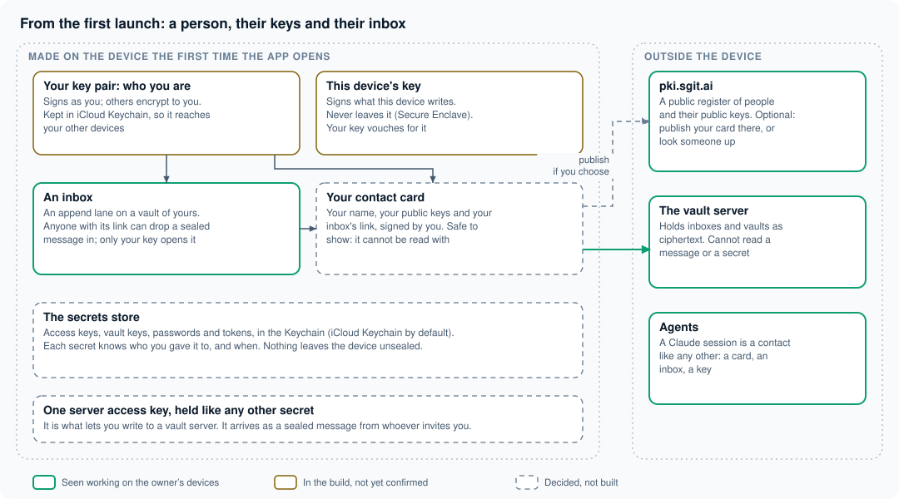
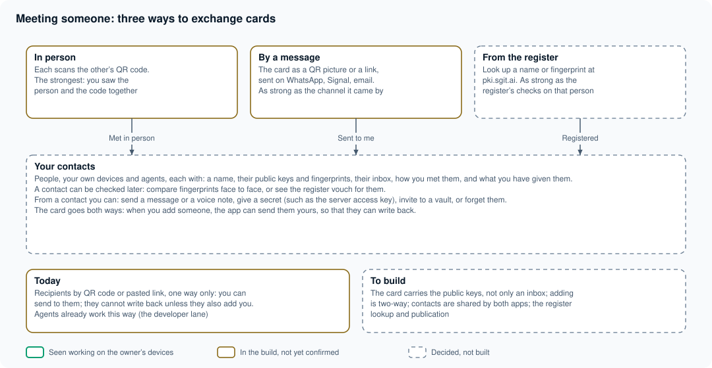
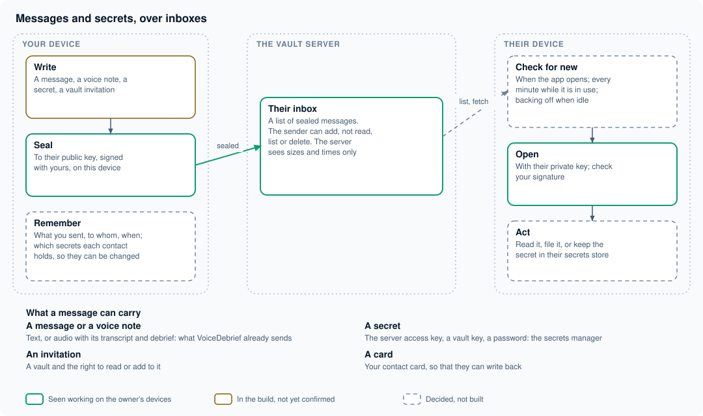

# People, messages and secrets: the layer under both apps

**Kind:** an architecture and a brief. **From:** the owner, 14 November 2026: "anybody who installs the app has a public and private key straight away ... register people, kind of like PKI ... identities from the website, and identities shared by QR code, in person or in a WhatsApp message ... a messaging system ... your device becomes the management layer ... a full-blown secrets manager." Written up by the agent working on the repository. Intention, not fact: [what is built](../../built/index.md) says what exists.

The idea in one line: **every install is a person with keys and an inbox; people meet by exchanging cards; everything they send each other, including secrets, is sealed to the recipient's key and dropped in their inbox.** VoiceDebrief and SGit Vaults both stand on it, and so does a secrets manager.

## 1. From the first launch

- **Your key pair** (RSA-OAEP 4096 to receive, ECDSA P-256 to sign; the sgit key bundle). Made at first launch, kept in iCloud Keychain so that your other devices have it. *Built in VoiceDebrief (`PKIKit`, the Identity screen); made when asked for, not at first launch; untried on a device.*
- **This device's key**, in the Secure Enclave where there is one, vouched for by your key. *Built in VoiceDebrief; untried.*
- **An inbox**: an append lane on a vault of yours. Anyone holding its link can drop a sealed message in; only your key opens it. *The lane works today (every note sent to the developer goes this way); an inbox per person is not built.*
- **A contact card**: your name, your public keys, your inbox's link, signed by you. Shown as a QR code or a link. *Not built: today's QR code carries an inbox link and one public key, not a signed card.*
- **The secrets store**: access keys, vault keys, passwords and tokens, in the Keychain. Each secret remembers who it was given to. *Not built.*

## 2. Meeting someone

| Way | How | How far to trust it |
|---|---|---|
| In person | Each scans the other's QR code | The most: you saw the person and the code together |
| By a message | The card as a QR picture or a link, on WhatsApp, Signal, email | As far as the channel it came by |
| From the register | Look up a name or fingerprint at pki.sgit.ai | As far as the register's checks on that person |

A contact keeps how it was met, and can be checked later (fingerprints compared face to face, or the register vouching). Adding is **two-way**: when you add someone, the app offers to send them your card, so they can write back. Agents are contacts like any other: a Claude session has a card and an inbox (`tools/conductor/` makes them).

## 3. Messages and secrets

A message is sealed to the recipient's public key and signed with the sender's, on the sender's device (the envelope `PKIKit` already makes). It can carry text, a voice note (what VoiceDebrief sends today), **a secret**, a vault invitation, or a card.

**Checking for new messages.** There are no push events, so the app asks: when it opens or comes to the front, every minute while it is in use, and less and less often when idle (the owner's pattern from the website). One list call on one inbox per check: little traffic.

## 4. The secrets manager

The owner's point: there is a gap in the market, because sharing a secret safely is still awkward. Here it is one gesture: pick the secret, pick the contact, send. What it needs:

- **Kinds**: a server access key, a vault key, a password, an API token, a note.
- **Kept** in the Keychain (iCloud Keychain by default, a switch for this device only), with a backup in one of your vaults if you choose.
- **Shared** as a sealed message to a contact; **received** into the store with one tap.
- **Remembered**: who holds each secret and since when, so that a secret can be changed and the new value sent to everyone who should have it, and nobody who should not.
- **Shown** only after Face ID or the passcode, copied with an expiry on the clipboard.

## 5. The access key, and the first message

A person needs the server access key to write to a vault server, including to create their own inbox. The owner's assumption: everyone who uses the app is given it. That makes it the first secret most people will receive, which raises a chicken-and-egg question: how does it arrive before they have an inbox?

The answer this design proposes: **the first exchange carries it.** The newcomer shows their card (their public key, no inbox yet); whoever invites them seals the access key to that key and sends it back by the same route, a QR code or a WhatsApp message. A sealed secret is safe on WhatsApp: only the newcomer's key opens it. With the access key in their store, the newcomer's app creates their inbox and sends their full card. This also settles issue 110 for SGit Vaults: a teammate receives the access key as a secret, held and remembered like any other.

## Where it is built

One Swift package shared by both apps (proposed name `SGitPeople`): the key bundle (moving `PKIKit` out of VoiceDebrief), contact cards, contacts, inboxes and the check for new messages, the message format, and the secrets store. Each app adds its own screens. A dedicated session builds it.

## Decisions for the owner

1. **Access key distribution** as in section 5, or each person brings their own.
2. **The card's format**: a new signed card, compatible with pki.sgit.ai's key bundle (proposed), shown as a QR code and a link.
3. **Where inboxes live**: on each person's own vault (proposed), or one shared vault for a team.
4. **The register**: publishing to pki.sgit.ai optional and off by default (proposed).
