# The visual identity: one family, two apps

How VoiceDebrief and SGit Vaults look, and why: colour, type, spacing, corners, the marks, the icons and the pictures. Decided on 14 November 2026 after the owner asked for "a very strong visual identity" and "icons for everything". The [design](../index.md) says how the apps behave; this page says how they look. Everything here is in the code: `Sources/UI/Design/` in each app, and `tools/art/` for every picture.

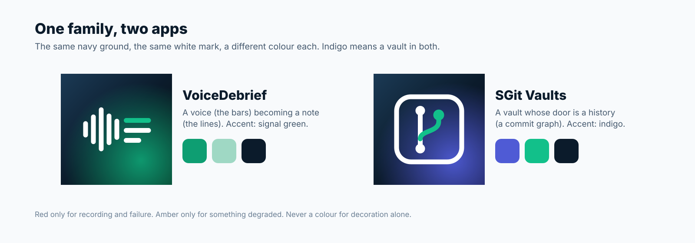

## Five decisions

| | Decision |
|---|---|
| Ground | A deep navy, `#0B1B2B`, is the family's ground: the app icons, the drawings, the hero banners. The screens themselves stay in Apple's system colours, light and dark |
| One accent per app | VoiceDebrief is signal green, `#0E9E72`. SGit Vaults is indigo, `#4F5BD5`. Indigo means a vault in both apps, so the Vaults section of VoiceDebrief is indigo too |
| Colour carries meaning | Red only for recording and failure. Amber only for something degraded. Every section has one colour, used for its icon, its tile and its picture, and nothing else |
| One symbol per thing | Every section, action and state has one SF Symbol, kept in one file (`Icons.swift`, and `Sections.swift` for sections), so the same thing looks the same everywhere |
| A picture per section | Each part of the app has a drawing in the house style: on the home screen's tiles, as a banner where a section begins, in empty states. No picture contains words, and none shows something the app does not do |

## Colour

| Token | Light | Dark | Used for |
|---|---|---|---|
| `DS.Palette.navy` | `#0B1B2B` | `#0B1B2B` | The family ground: icons, drawings, banners |
| `DS.Palette.green` | `#0E9E72` | `#12C08A` | VoiceDebrief's accent; the record control; saved and done |
| `DS.Palette.mint` | `#9FD8C4` | `#9FD8C4` | Highlights in drawings |
| `DS.Palette.indigo` | `#4F5BD5` | `#7C86F0` | SGit Vaults' accent; anything to do with a vault, in both apps |
| `DS.Palette.amber` | `#B98500` | `#F0B429` | Degraded: worked, but not fully |
| `DS.Palette.red` | `#D93A3F` | `#FF6B6B` | Recording and failure only |
| `DS.Palette.hairline` | primary at 9% | primary at 9% | The edge of a card. There are no shadows on screens |

The accent colours are the asset catalogues' `AccentColor`, so every system control takes them without code.

## Sections: one colour, one symbol, one picture

VoiceDebrief's parts, in the order of the sidebar. The tab bar, the sidebar, the home screen's tiles and each section's banner all read from `RootTab` in `Sources/UI/Design/Sections.swift`, so they cannot disagree.

| Picture | Section | Symbol | Colour | The tile's line |
|---|---|---|---|---|
| 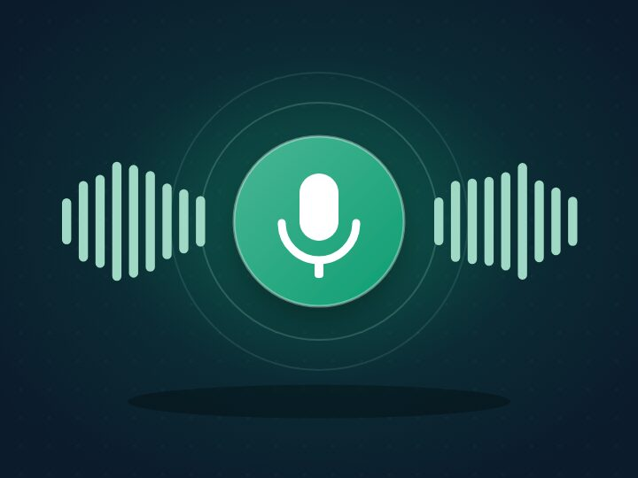 | Record | `mic.fill` | `#0E9E72` | A voice note in, a transcript and a debrief out |
|  | Library | `tray.full` | `#2F80ED` | Every note, by day |
|  | Contacts | `person.2` | `#E5577E` | Who notes go to; add one by QR code |
|  | Vaults | `lock.shield` | `#4F5BD5` | Encrypted copies that you own |
|  | Guide | `book` | `#2BA3D9` | What is new, every idea, how things work |
| 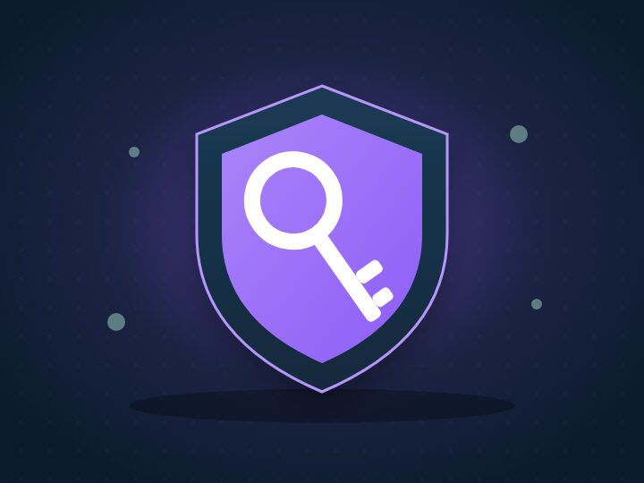 | Identity | `person.badge.key` | `#8E5CF7` | Your keys and your devices |
| 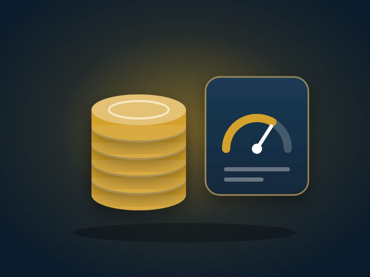 | Credit | `sterlingsign.circle` | `#D4A12A` | What each thing costs |
| 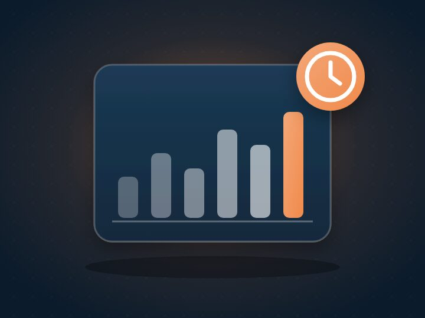 | Your activity | `chart.bar` | `#F08A4B` | What you have used; send it |
|  | Lab | `flask` | `#13A8C8` | Try Apple's model, tools on and off |
|  | Your words | `character.book.closed` | `#2BB39A` | Names the clean text should know |
|  | What this build does | `checklist` | `#12C08A` | Built, in test, not built |
|  | Settings | `gearshape` | `#8A9BB0` | Language, saving, diagnostics |

SGit Vaults' parts, from `SGSection` in its own `Sections.swift`:

| Picture | Section | Symbol | Colour |
|---|---|---|---|
|  | Vaults | `lock.shield` | `#4F5BD5` |
| 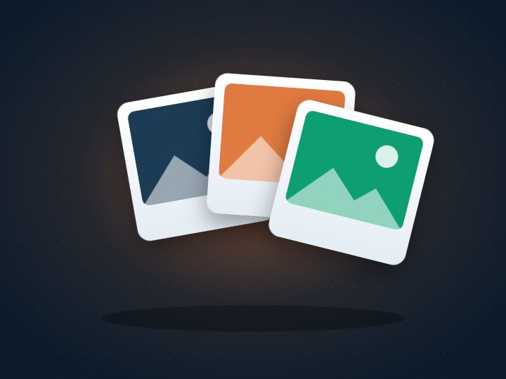 | Gallery | `square.grid.2x2` | `#E07A3F` |
| 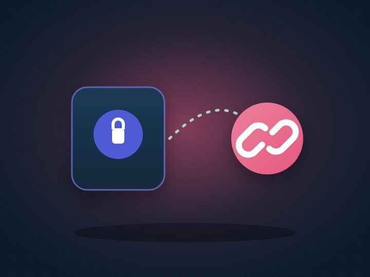 | Share | `link` | `#E5577E` |
| 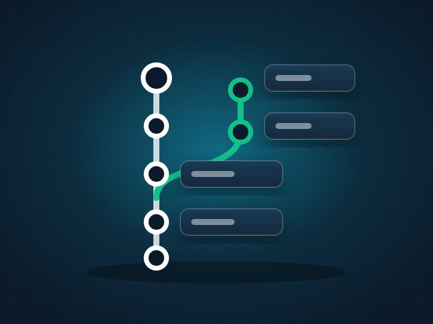 | History | `clock.arrow.circlepath` | `#13A8C8` |
| 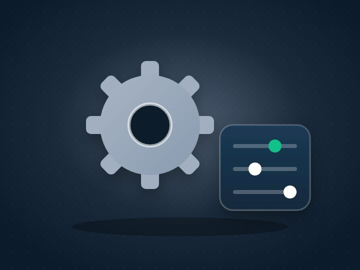 | Settings | `gearshape` | `#8A9BB0` |

## Actions and states

From `Icons.swift`, the same in both apps.

| Meaning | Symbol | | Meaning | Symbol |
|---|---|---|---|---|
| Record | `mic.fill` | | Done | `checkmark.circle.fill` |
| Finish | `checkmark` | | Working | `clock.arrow.circlepath` |
| Share | `square.and.arrow.up` | | Degraded | `exclamationmark.triangle.fill` (amber) |
| Save to a vault | `lock.shield` | | Failed | `xmark.octagon.fill` (red) |
| Send | `paperplane.fill` | | In a vault | `lock.shield.fill` (indigo) |
| Discard | `trash` | | Sent | `paperplane.circle.fill` |
| Try again | `arrow.clockwise` | | On this device | `iphone` |
| Scan a QR code | `qrcode.viewfinder` | | A note | `waveform` |
| Language | `globe` | | What is new | `sparkles` |

A state is shown as a `StatusPill`: the symbol and a word or two in the state's colour, on a 12% wash of it. Never colour alone.

## Type, spacing and corners

- **Type.** Apple's system font throughout, so Dynamic Type and every language work. Display text, titles and numbers use the rounded design (`DS.TypeScale.display`, `.title`, `.number`): the timer, a section's banner, the balance. Body text is the plain system font.
- **Spacing.** A 4-point grid: 4, 8, 12, 16, 24, 32, 48 (`DS.Space`). Screens are padded 16 or 20 at the edges, and content is held to a readable width on iPad and Mac.
- **Corners.** Continuous curves always. 12 for a control or thumbnail, 18 for a card, 26 for a banner, and a section icon's square at 28% of its size (`DS.Radius`).
- **Surfaces.** A card is the grouped surface colour with a hairline edge (`dsSurface()`), no shadow. Depth belongs to the drawings, not the screens.

## The marks and the app icons

VoiceDebrief's mark is a voice becoming a note: five rounded bars, the sound, turning into three lines, the text, the first line green. SGit Vaults' mark is a vault whose door is a history: a rounded square holding a commit graph with one green branch. Both are white on the same navy, lit from the lower right by the app's own colour. They are drawn as code (`iconVoiceDebrief` and `iconSGit` in `tools/art/art.mjs`) and rendered to the 1024-pixel `AppIcon.png` in each asset catalogue.

| VoiceDebrief | SGit Vaults |
|---|---|
| 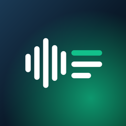 | 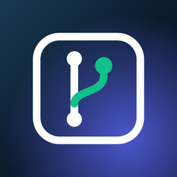 |

## The pictures

**The house style.** A navy night card; a soft glow of the section's colour behind one subject; flat, rounded shapes with gentle gradients; off-white highlights; depth from one soft shadow; a faint dot grid. No words, no faces, no logos. One subject per picture, centred, with room around it so it reads at the size of a tile.

**How they are made.** Every picture is a function in `tools/art/art.mjs` that returns an SVG; `node tools/art/render.mjs` renders them in Chromium and writes 720 by 540 JPEGs (about 20 KB each) into the asset catalogues (`Art/VDArt-*`, `Art/SGArt-*`) and into `website/assets/art/` for this site. Changing a picture is changing its function and running the script.

**Pictures from image models.** The owner offered image models through OpenRouter. `tools/imagegen/` holds a generator for them that records each image's model and prompt in `images.json`, so any picture made that way can be remade. Its first run was refused because the key had reached its spending limit, so the section pictures and the app icons are drawn as code. Once the limit was raised, the generator made the first-visit pictures of both apps (`VDArt-hero`, `SGArt-hero`) and two of the infographics below, for about $0.04 each; each image's model, prompt, date and cost are written beside it in `images.json` when it is made. A generated picture may replace a drawn one if it keeps to the house style above.

## Infographics

Explanations on the site are drawn in the same style, on a light ground, with words. Each is checked against [what is built](../../built/index.md) before it is published.

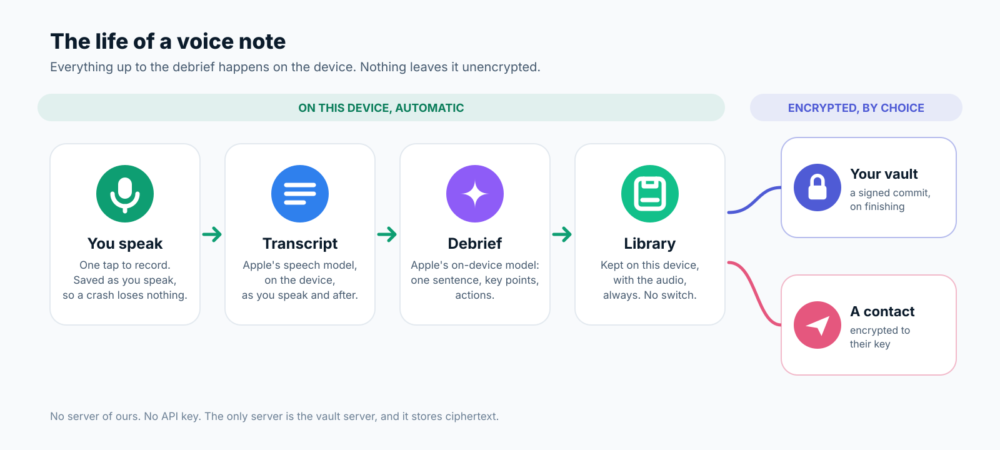

Two more, made by an image model (Gemini through OpenRouter) from the prompts in `tools/imagegen/images.json`, and read word by word before they were used:

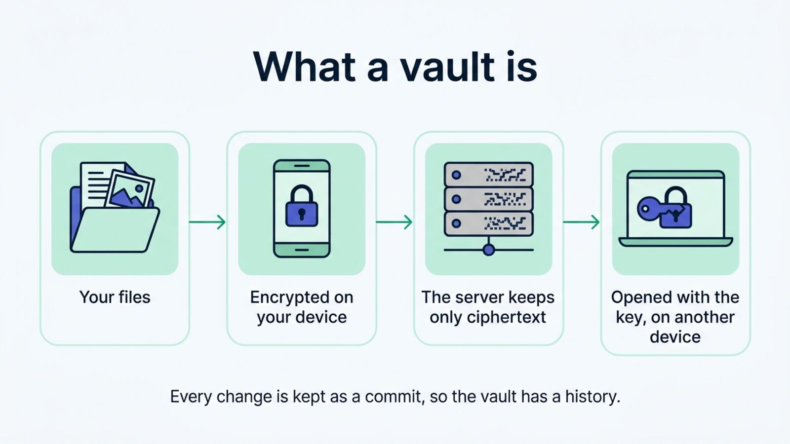

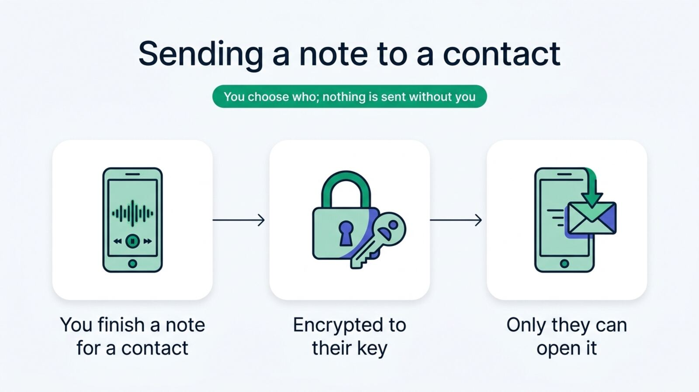

## Where it is applied

- **Built:** the tokens, sections, icons and components in both apps; the new app icons; SGit Vaults' indigo accent; the tab bar and sidebar reading from `RootTab`; the record screen's Explore tiles with a picture each; a banner on the record screen before the first note; the record control in the house green with its ring; cards with a hairline; in SGit Vaults, a banner when there are no vaults and illustrated rows for Gallery and Settings.
- **Next, screen by screen:** a banner at the top of each section; empty states with their picture; the note screen's cards and state pills; Library rows with state pills; the vault screens in indigo.
