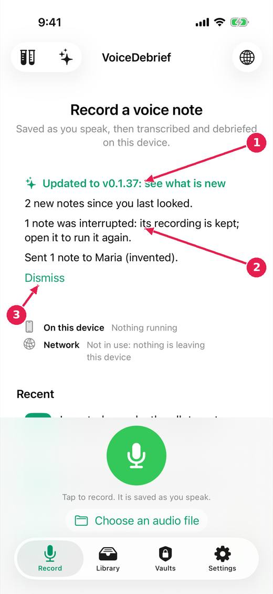

# What happened since you last looked

When you open the app, a card on the Record tab says what is new: an update, with a link to what changed, and what happened to your notes since you last opened it. The app works it out from the library; it is not written by a model. The Guide's What is new lists every version, with those you skipped marked.

[Every guide](../index.md) · [Ideas and where they stand](../../ideas/index.md)

## 1. The briefing card on the Record tab.

1. The app was updated: tap to see what is new in this version.
2. What happened since you last looked: new notes, interrupted ones, sends and saves.
3. Dismiss it. The card is worked out again each time the app opens.

## Where this stands

- The version in plain sight, release notes worth reading, and a briefing on opening: **In progress**. The issue says: "Items 3 and 4 begun (untried on a device): the app notices an update and links its page; a briefing card says what happened since the last opening, worked out..."

*Pictures: iPhone, light, from screens.yml run 39 on dev (commit 1d21781, 14 November 2026). Newer builds may differ: the record screen now chooses who a note is for above the record control.*
