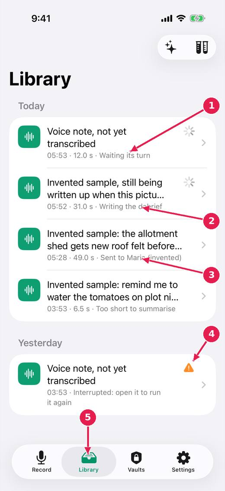

# The library: every note, and what each one is doing

Every note kept on this device, newest first, by day. Each row says what the note is doing or what you can do with it.

[Every guide](../index.md) · [Ideas and where they stand](../../ideas/index.md)

## 1. The Library tab.

1. Waiting its turn: notes are written up one at a time, and you can keep recording meanwhile.
2. Being written up now.
3. Finished, and sent to somebody.
4. Interrupted: the recording is kept. Open it and run it again.
5. The Library tab, from anywhere.

## Where this stands

- States that say what to do next: **Built, untried**. The issue says: "Built (untried on a device): row states say what to do or why; an untranscribed note is "Voice note, not yet transcribed"; a cut title ends with an ellipsis..."
- Record again while the last note is being written up: **Built, untried**. Done in the code, and the issue says: "Built (untried on a device): recording and processing are separate; notes queue for the pipeline and say "Waiting its turn"; the control stays live, and its..."

*Pictures: iPhone, light, from screens.yml run 39 on dev (commit 1d21781, 14 November 2026). Newer builds may differ: the record screen now chooses who a note is for above the record control.*
