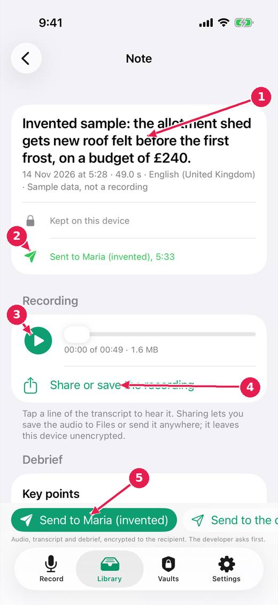
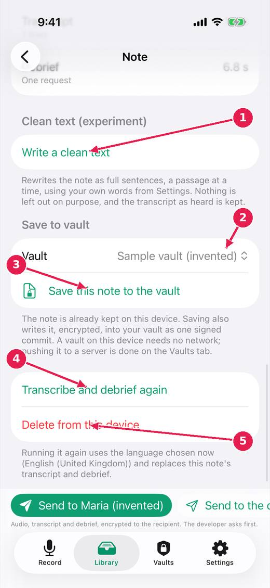

# Open a note: listen, send, save

A note opens with its one sentence as the heading, then what has happened to it, the recording, the transcript and the debrief. Everything you can do with it is on this screen.

[Every guide](../index.md) · [Ideas and where they stand](../../ideas/index.md)

## 1. The top of a finished note.

1. The note in one sentence, written by Apple's model on this device.
2. What happened to it: kept on this device, sent to whom and when, saved to which vault.
3. Play the recording. Tapping a line of the transcript plays from that moment.
4. Share or save the recording, for example to Files. It leaves the device unencrypted.
5. Send it: one button per recipient, encrypted to their key on this device.

## 2. The end of the same note.

1. Write a clean text: an experiment that rewrites the note as full sentences, using your own words from Settings.
2. Which vault to save into.
3. Save this note to the vault, encrypted, as one signed commit. Finished notes are saved on their own unless that is switched off in Settings.
4. Transcribe and debrief again, in the language chosen now.
5. Delete the note from this device. It asks first.

## Where this stands

- Play a recording, and show how long an interrupted one is: **Built, untried**. Done in the code, and the issue says: "Built (untried on a device): a player on every note with audio, length and size shown, a transcript line plays from its moment. Status: open. From review round..."
- The gist first on a note: **Built, untried**. Done in the code, and the issue says: "Built (untried on a device): the one sentence is the heading with the date beneath; it is not repeated at the end; the clean text section is below the..."
- A copy off the phone that anyone can make: **Built, untried**. The issue says: "Built (untried on a device): "Share or save the recording" on every note with audio, through the share sheet (Save to Files, AirDrop, any app); the footer says..."
- A send that can be seen, stopped and not lost: **Built, untried**. The issue says: "Built (untried on a device): pendingSend and sendProblem kept on the note on disk; waiting sends resumed at launch and when the note is ready; Do not send on..."
- Finishing saves to the vault; discarding is the awkward path: **In progress**. The issue says: "Built (untried on a device): the control that ends a recording is green with a tick and says the note is kept; Discard is a small red word at the top of the..."

*Pictures: iPhone, light, from screens.yml run 39 on dev (commit 1d21781, 14 November 2026). Newer builds may differ: the record screen now chooses who a note is for above the record control.*
