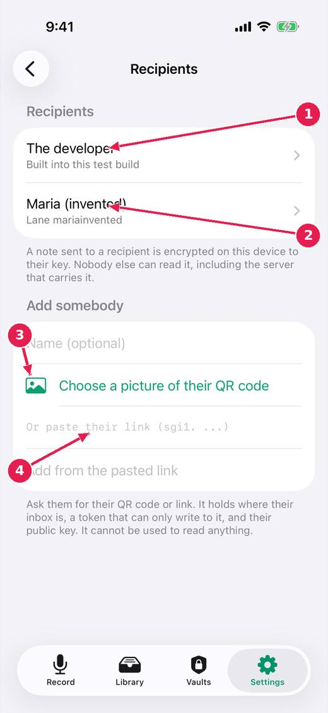

# Send a note to somebody

A recipient is a person, another device or an agent session that has given you their link. A note sent to them is encrypted on this device to their key: nobody else can read it, including the server that carries it.

[Every guide](../index.md) · [Ideas and where they stand](../../ideas/index.md)

## 1. Settings, Recipients.

1. Built into this test build: the developer, who can read what you send. It asks before sending.
2. Somebody you have added.
3. Add somebody from a picture of their QR code, or scan it with the camera.
4. Or paste their link. It can only write to their inbox: it cannot read anything.

## Where this stands

- Lanes are recipients, and the app has an inbox: **In progress**. The issue says: "Built: recipients with names; add by QR code (camera or a picture) or pasted link; one Send button per recipient on a note; a recipient's QR code shown so it..."
- Act on a note at once: send without waiting, controls that do not move: **In progress**. The issue says: "Built (untried on a device): the Send buttons are a bar fixed at the bottom of the note, in the same place whatever the note above is doing; pressing one before..."
- A send that can be seen, stopped and not lost: **Built, untried**. The issue says: "Built (untried on a device): pendingSend and sendProblem kept on the note on disk; waiting sends resumed at launch and when the note is ready; Do not send on..."

*Pictures: iPhone, light, from screens.yml run 39 on dev (commit 1d21781, 14 November 2026). Newer builds may differ: the record screen now chooses who a note is for above the record control.*
