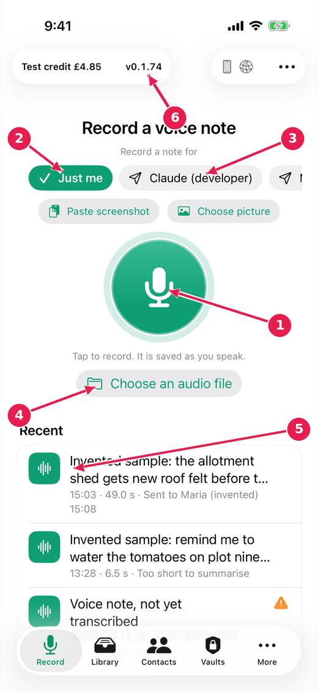
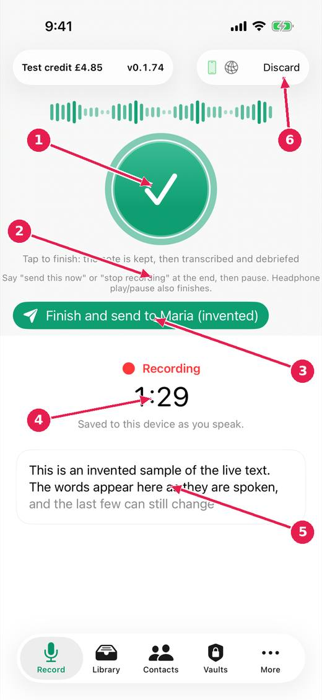

# Record a voice note

Choose who the note is for, then one button records. The recording is saved into the note while you speak, so a call or a crash cannot lose it. When you finish, the note is transcribed and debriefed on this device by Apple's models, and sent if it was for someone.

[Every guide](../index.md) · [Ideas and where they stand](../../ideas/index.md)

## 1. The Record tab, before you start.

1. Tap to record. It is saved as you speak.
2. Just me: the note stays with you.
3. Or choose who it is for: finishing then sends it, encrypted, when it is written up.
4. Or choose an audio file you already have (.m4a, .mp3 or .wav).
5. Your most recent notes. Tap one to open it.
6. The version: tap it to see what changed. Beside it, the test credit; no money is taken.

## 2. While recording.

1. Tap to finish. The note is kept, then transcribed and debriefed.
2. Or say "send this now" or "stop recording" at the end, or press play/pause on headphones.
3. Finish and send in one press, to the person chosen before you started.
4. How long you have been recording. Everything so far is already kept on the device.
5. The words as you say them: a preview. The transcript that is kept is made from the recording.
6. Discard, if you do not want this recording. It asks first.

## Where this stands

- Record again while the last note is being written up: **Built, untried**. Done in the code, and the issue says: "Built (untried on a device): recording and processing are separate; notes queue for the pipeline and say "Waiting its turn"; the control stays live, and its..."
- Act on a note at once: send without waiting, controls that do not move: **In progress**. The issue says: "Built (untried on a device): the Send buttons are a bar fixed at the bottom of the note, in the same place whatever the note above is doing; pressing one before..."
- Show where the work happens; small remarks from the model; talking to the app: **In progress**. The issue says: "Item 1 begun (untried on a device): two lines on the record screen, on this device and network, green while busy. Lane sends are shown; vault push and pull..."

*Pictures: VoiceDebrief: iPhone, light, from screens.yml run 43606968488 on work/sherpa at 0f2e6f8 (the same tree as dev, v0.1.74, 14 November 2026), after the design session's restyle.*
