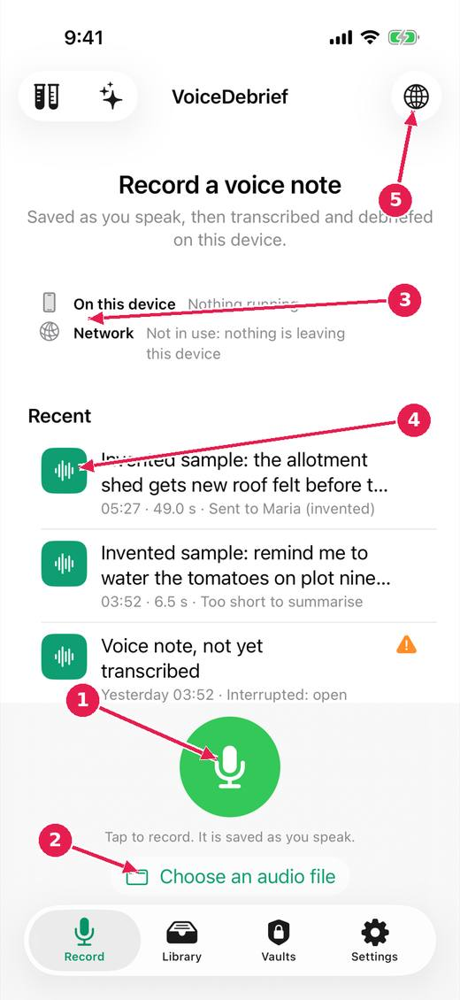
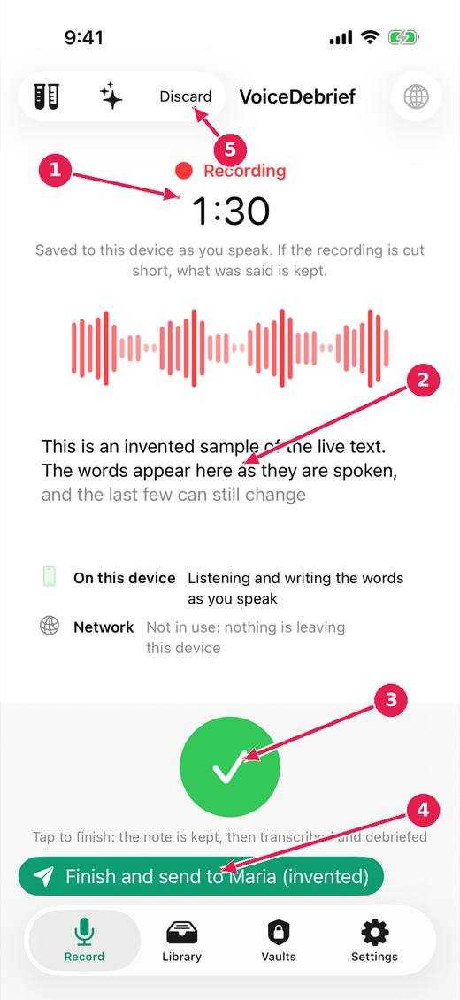

# Record a voice note

One button records. The recording is saved into the note while you speak, so a call or a crash cannot lose it. When you finish, the note is transcribed and debriefed on this device by Apple's models.

[Every guide](../index.md) · [Ideas and where they stand](../../ideas/index.md)

## 1. The Record tab, before you start.

1. Tap to record. It is saved as you speak.
2. Or choose an audio file you already have (.m4a, .mp3 or .wav).
3. Where the work happens: on this device, or on the network. Green while something is busy.
4. Your most recent notes. Tap one to open it.
5. The language you will speak in. Apple's speech model needs it before it listens.

## 2. While recording.

1. How long you have been recording. Everything so far is already kept on the device.
2. The words as you say them: a preview. The transcript that is kept is made from the recording when you finish.
3. Tap to finish. The note is kept, then transcribed and debriefed.
4. Finish and send in one press, to a recipient you have added.
5. Discard, if you do not want this recording. It asks first.

## Where this stands

- Record again while the last note is being written up: **Built, untried**. Done in the code, and the issue says: "Built (untried on a device): recording and processing are separate; notes queue for the pipeline and say "Waiting its turn"; the control stays live, and its..."
- Act on a note at once: send without waiting, controls that do not move: **In progress**. The issue says: "Built (untried on a device): the Send buttons are a bar fixed at the bottom of the note, in the same place whatever the note above is doing; pressing one before..."
- Show where the work happens; small remarks from the model; talking to the app: **In progress**. The issue says: "Item 1 begun (untried on a device): two lines on the record screen, on this device and network, green while busy. Lane sends are shown; vault push and pull..."

*Pictures: iPhone, light, from screens.yml run 39 on dev (commit 1d21781, 14 November 2026). Newer builds may differ: the record screen now chooses who a note is for above the record control.*
