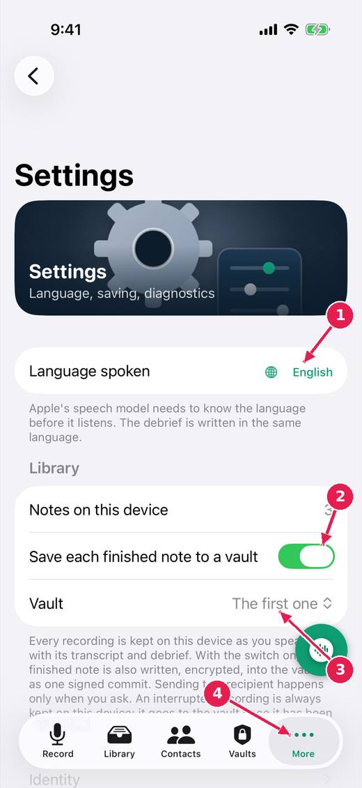
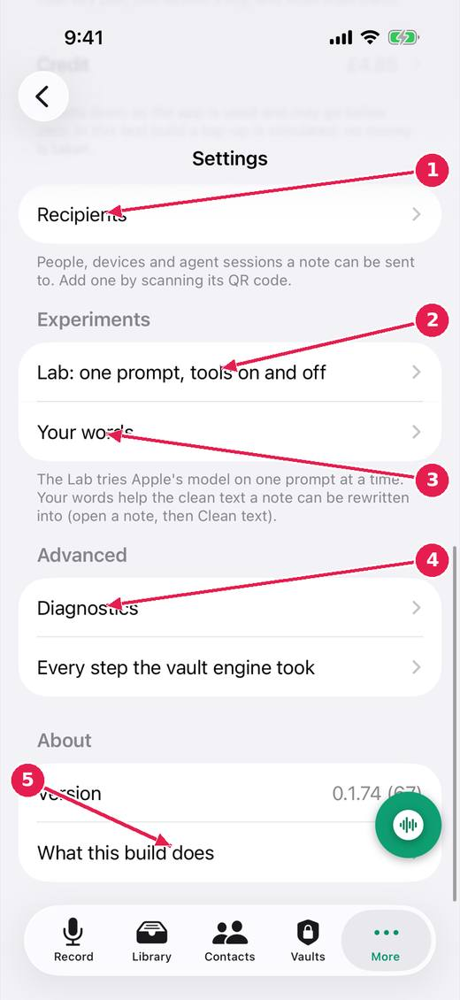

# Settings: language, saving, experiments

Settings is under More, with the few things to set once, and the places for the rest: who you send to, the experiments and what the app has done.

[Every guide](../index.md) · [Ideas and where they stand](../../ideas/index.md)

## 1. More, Settings.

Settings is under More. The first things are the ones to set once: the language you speak in, and whether each finished note is saved to a vault.

1. The language you speak in.
2. Save each finished note to a vault, on by default.
3. Which vault: the first one, or one you choose.
4. More holds Settings, Identity, Credit and the other sections.

## 2. Further down.

Further down are the places for the rest: who you can send to, the experiments, and what the app has done, for when something needs explaining.

1. Recipients: who a note can be sent to.
2. The Lab: one prompt to Apple's model, with tools on and off.
3. Your words: names and terms the clean text should spell your way.
4. Diagnostics and every step the vault engine took.
5. What this build does: what is built, in test, and not built.

## Where this stands

- Finishing saves to the vault; discarding is the awkward path: **In progress**. The issue says: "Built (untried on a device): the control that ends a recording is green with a tick and says the note is kept; Discard is a small red word at the top of the..."
- The lab, first experiment (L01): one prompt, tools on and off: **In progress**. The issue says: "Built and in the test build: the Lab under Settings, L01, four read-only tools, six presets, the export. Compiled and unit tested in CI; never run against a..."
- A clean text instead of a summary, with questions where the note is unclear: **In progress**. Open, and the reality file lists for it: A clean text, with questions.

*Pictures: VoiceDebrief: iPhone, light, from screens.yml run 43606968488 on work/sherpa at 0f2e6f8 (the same tree as dev, v0.1.74, 14 November 2026), after the design session's restyle.*
