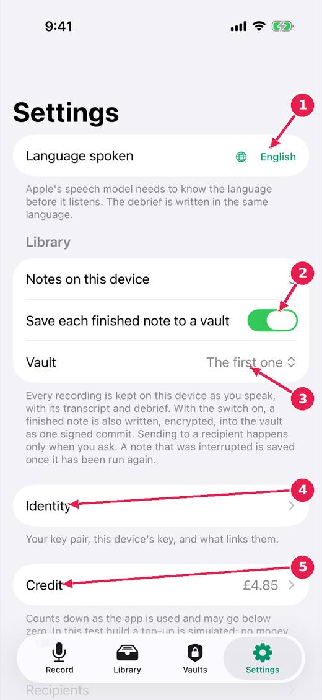

# Settings: language, saving, identity, credit

The few things to set once, and the places for the rest: who you are, who you send to, and the experiments.

[Every guide](../index.md) · [Ideas and where they stand](../../ideas/index.md)

## 1. The Settings tab.

1. The language you speak in.
2. Save each finished note to a vault, on by default.
3. Which vault: the first one, or one you choose.
4. Identity: your key pair, this device's key, and what links them.
5. Credit: a balance that counts down as the app is used. In this test build no money is taken.

## Where this stands

- Finishing saves to the vault; discarding is the awkward path: **In progress**. The issue says: "Built (untried on a device): the control that ends a recording is green with a tick and says the note is kept; Discard is a small red word at the top of the..."
- The user's key pair, the device key, and vouching (with issue 005): **In progress**. The issue says: "Built: PKIKit (issue 005, done), the Identity screen under Settings, the user's key pair in iCloud Keychain, the device key, the vouching statement and its..."
- Credit, charging per use, top-up: **In progress**. Open, and named by the release notes of v0.1.20.

*Pictures: iPhone, light, from screens.yml run 39 on dev (commit 1d21781, 14 November 2026). Newer builds may differ: the record screen now chooses who a note is for above the record control.*
