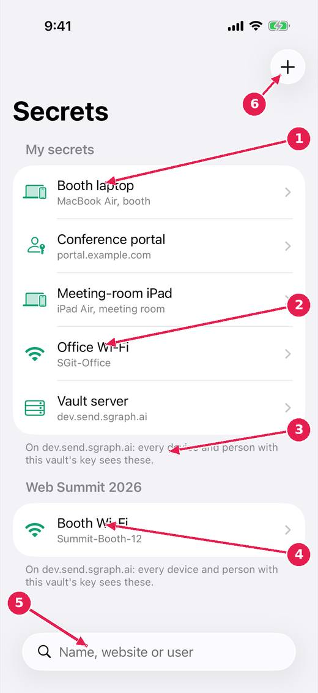
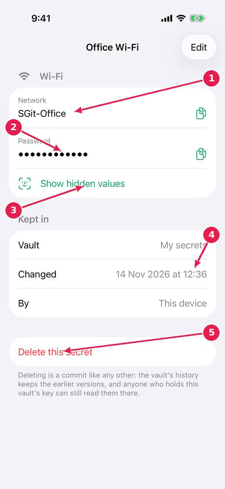
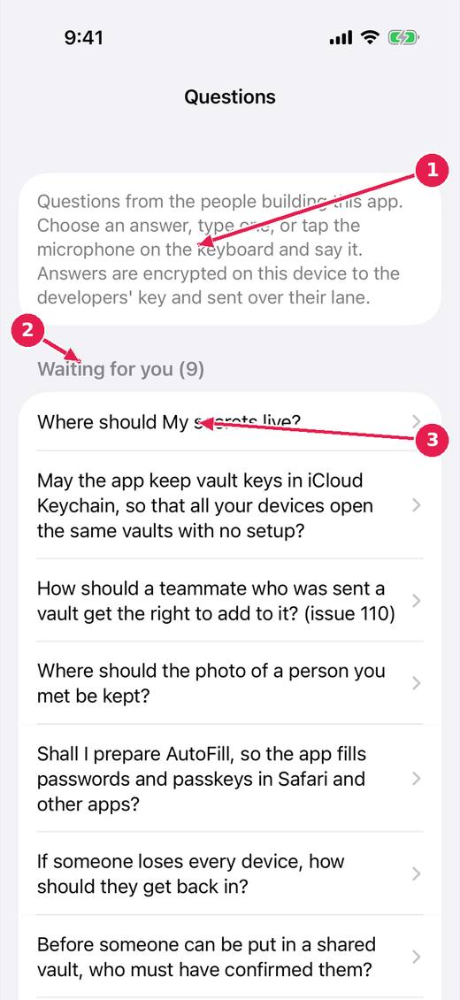

# SGit Vaults: secrets, kept in a vault

A secret is a password, a Wi-Fi network, a server or a card, kept as one encrypted file in a vault, behind Face ID. A secret in a shared vault is seen by everyone who holds that vault's key, and each change is a signed commit.

[Every guide](../index.md) · [Ideas and where they stand](../../ideas/index.md)

## 1. The Secrets list.

1. Your own secrets, in a vault of your own.
2. Each kind has its own fields: a device, a website login, a Wi-Fi network, a server.
3. Who can see them: every device and person with this vault's key.
4. A team vault's secrets, listed under its name.
5. Search by name, website or user.
6. Add a secret.

## 2. One secret.

1. Each field, with a button to copy it.
2. Hidden values stay masked.
3. Show hidden values, after Face ID.
4. Which vault it is kept in, when it changed and by which device.
5. Delete it: a commit like any other, so the vault's history keeps the earlier versions.

## 3. Questions for you.

1. Questions from the people building the app. Answer by choosing, typing or speaking; answers are encrypted to the developers' key.
2. How many are waiting.
3. Tap one to answer it.

## Where this stands

- Secrets as files in vaults: **Built, untried**. Listed on the design page "A secrets manager made of people and vaults" as built, not yet proven.
- Questions for the owner, by voice: **Built, untried**. Listed on the design page "A secrets manager made of people and vaults" as built, not yet proven.

*Pictures: SGit Vaults: iPhone, light, from sgit-app-screens.yml run 43592618173 (work/sgit-app at 6b13fcb, landed on dev as 9ea9212, 14 November 2026), before the design session's restyle.*
