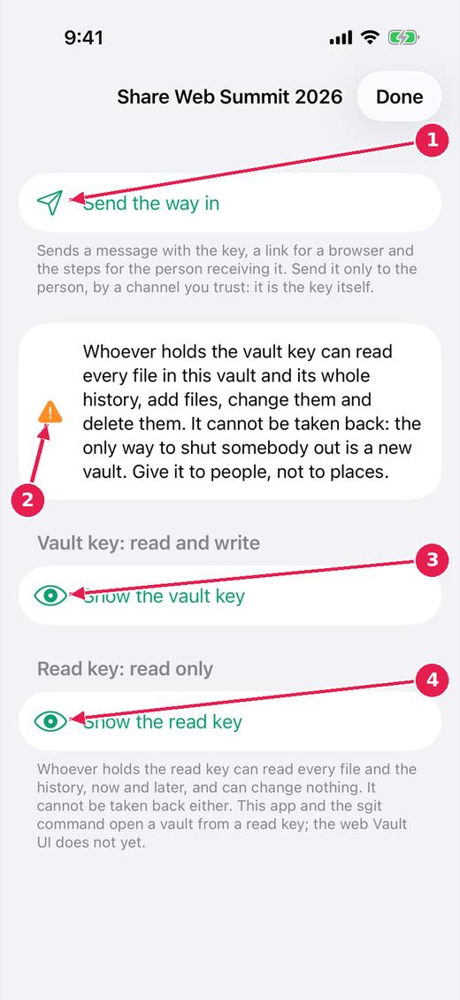
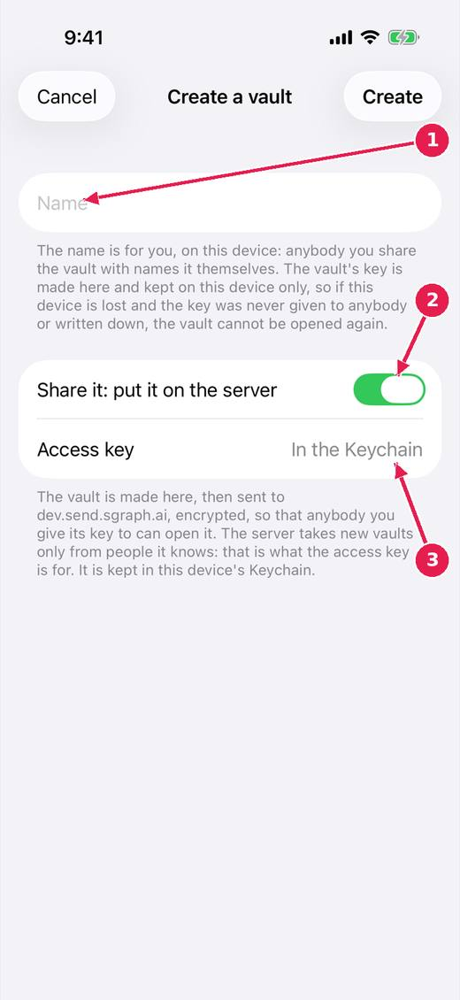

# SGit Vaults: share a vault, and create one on the server

Sharing gives somebody the vault's key. Whoever holds it can read everything in the vault, including its history, and it cannot be taken back: give it to people, not to places.

[Every guide](../index.md) · [Ideas and where they stand](../../ideas/index.md)

## 1. Share.

1. Send the way in: a message with the key, a link for a browser and the steps for the person receiving it. Send it only by a channel you trust.
2. What a key can do, said before you see it.
3. The vault key: read and write.
4. The read key: read only.

## 2. Create a vault.

1. A name, for you. The key is made here and kept on this device only.
2. Share it: put it on the server at once. Off, it stays on this device until you share it.
3. The access key the server needs to take a new vault, kept in the Keychain.

## Where this stands

- sgit app: sharing, for someone who was never told what a key is: **In progress**. Open, and named by the release notes of v0.1.44.
- sgit app: the Create sheet, the four keys, and smaller things: **In progress**. Open, and named by the release notes of v0.1.44.
- A read-only share that can be taken back: **Parked**. The issue's status: "Status: open. A question for the owner."

*Pictures: SGit Vaults: iPhone, light, from sgit-app-screens.yml run 19 on dev (commit e62bf68, 14 November 2026).*
