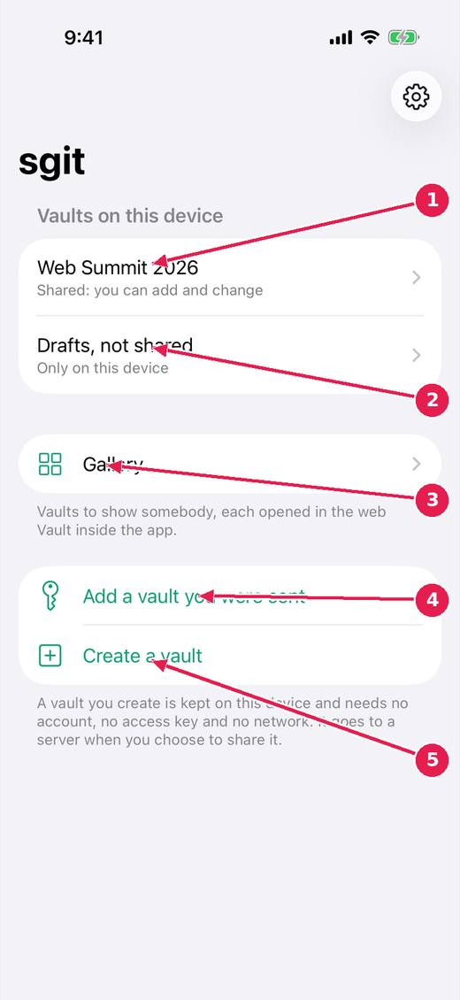
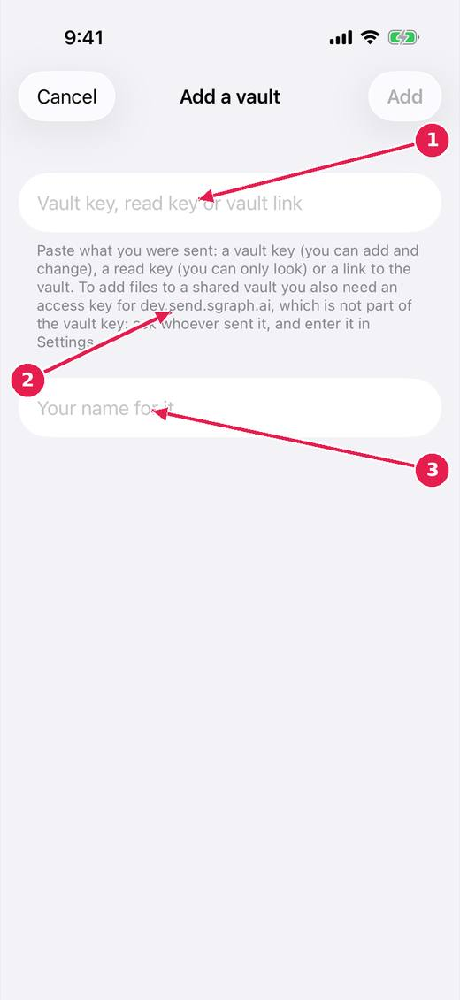

# SGit Vaults: open a vault you were sent, or make one

SGit Vaults keeps photos, videos and large files in an encrypted vault that a teammate can open. A vault you create is kept on this device and needs no account, no access key and no network until you share it.

[Every guide](../index.md) · [Ideas and where they stand](../../ideas/index.md)

## 1. The first screen.

1. A shared vault: on the server, and you can add and change.
2. A vault only on this device, not shared with anybody.
3. Gallery: vaults to show somebody, each opened in the web Vault inside the app.
4. Add a vault you were sent: paste or scan what you were given.
5. Create a vault, on this device.

## 2. Add a vault you were sent.

1. Paste the vault key, read key or link you were sent.
2. A read key can only look. To add files to a shared vault you also need an access key for the server, which is not part of the vault key: ask whoever sent it.
3. Your own name for the vault, on this device.

## Where this stands

- The sgit app, milestone one: **In progress**. The issue's Idea status line: "Much of milestone one is built: see website/sgit-app/built/index.md. Not yet used on a device against the live server."
- sgit app: a teammate sent a vault key cannot add to it: **In progress**. Open, and named by the release notes of v0.1.45.
- A gallery of vaults, opened in a browser inside the app: **In progress**. The issue says: "Built: a Gallery screen reached from the list of vaults. Entries have a name, a line about them, a topic and a link; they are grouped by topic and can be..."

*Pictures: SGit Vaults: iPhone, light, from sgit-app-screens.yml run 19 on dev (commit e62bf68, 14 November 2026).*
