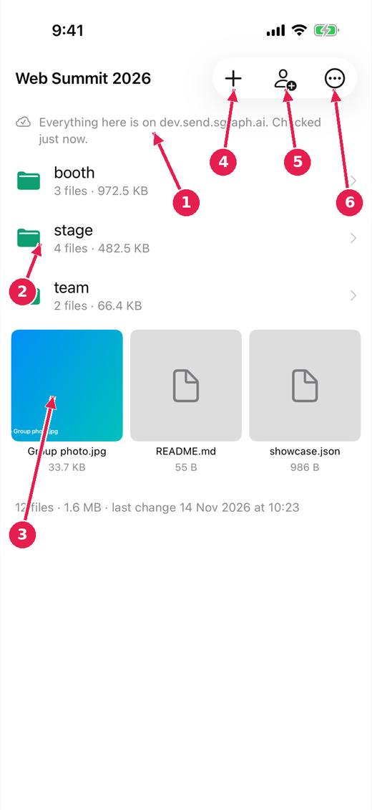
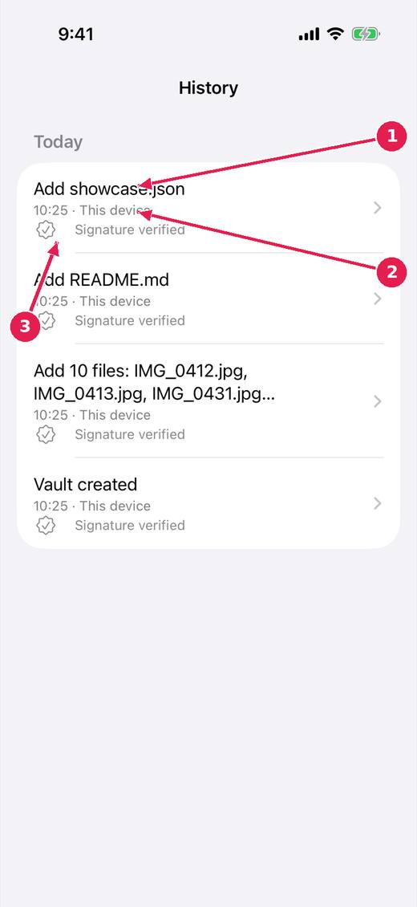

# SGit Vaults: inside a vault, and its history

A vault holds folders and files, like a folder on a computer, with every change kept as a signed commit.

[Every guide](../index.md) · [Ideas and where they stand](../../ideas/index.md)

## 1. A vault.

1. Whether everything is on the server, on this device only, or on its way in.
2. Folders, with how many files and how large.
3. Files: a picture shows a thumbnail. Tap one to open it, save it or share it.
4. Add photos, videos or files.
5. Share the vault with somebody.
6. More: history, saving a folder out, and the rest.

## 2. History.

1. Each change, newest first, grouped by day.
2. Who made it: this device, or another.
3. Each change is signed, and the signature is checked.

## Where this stands

- sgit app: say whether a file has arrived: **In progress**. Open, and named by the release notes of v0.1.44.
- sgit app: who added it: **In progress**. Open, and named by the release notes of v0.1.44.
- sgit app: getting a folder out, at full quality: **In progress**. Open, and named by the release notes of v0.1.44.

*Pictures: SGit Vaults: iPhone, light, from sgit-app-screens.yml run 19 on dev (commit e62bf68, 14 November 2026).*
