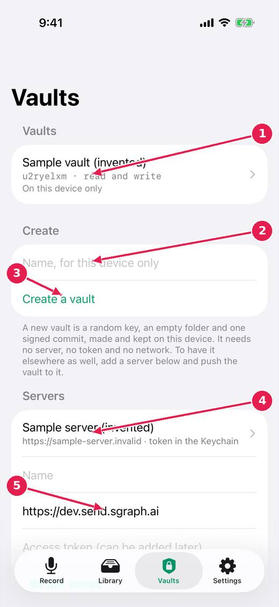
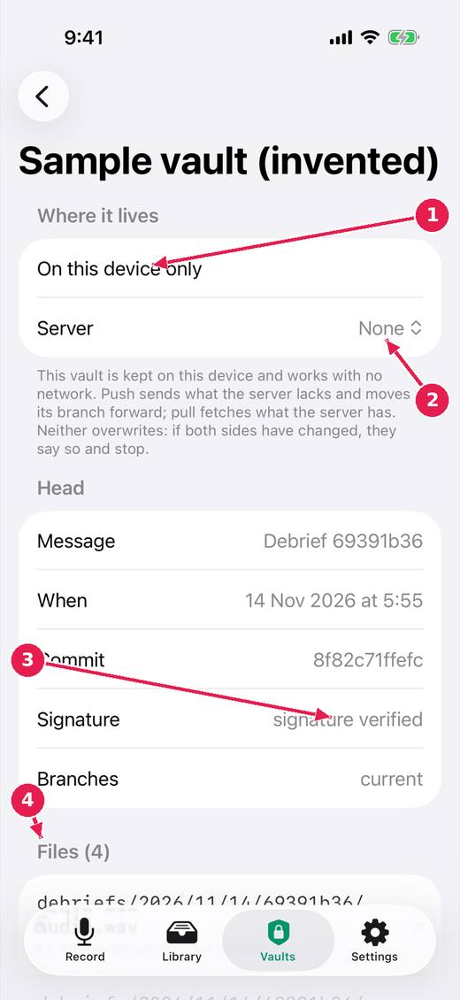

# Vaults: your notes, encrypted, on the device first

A vault is an encrypted, version-controlled folder you own. It is made on this device and needs no server and no network. A server is a remote you can push it to, so that it is kept elsewhere as well.

[Every guide](../index.md) · [Ideas and where they stand](../../ideas/index.md)

## 1. The Vaults tab.

1. Your vaults, and where each one is: on this device only, or on a server too.
2. A name for a new vault.
3. Create a vault: a random key, made and kept on this device.
4. Servers you can push a vault to. The access token is kept in the Keychain.
5. Add a server by its address.

## 2. Inside a vault.

1. Where it lives: on this device only, or also on a server.
2. Choose a server to push to and pull from. Neither ever overwrites: if both sides changed, it says so and stops.
3. The latest commit, and its signature checked.
4. The files in the vault: each saved note is a folder of debrief, transcript, run and audio.

## Where this stands

- Vaults are local first; a server is a remote: **Built, untried**. Done in the code, and the issue says: "Status: done in the code and its tests; not yet run on a device. See the article "The vault is a version-controlled store"."
- Vault keys and server tokens in iCloud Keychain, on by default: **Built, untried**. Done in the code, and the issue says: "Status: done in the code and its tests; not yet seen between two devices. Decided by the owner, 13 November 2026, and confirmed by him in the work/local-vaults..."
- A vault, for someone who has never met one: **In progress**. Open, and the reality file lists for it: Reviews from the pictures.

*Pictures: iPhone, light, from screens.yml run 39 on dev (commit 1d21781, 14 November 2026). Newer builds may differ: the record screen now chooses who a note is for above the record control.*
