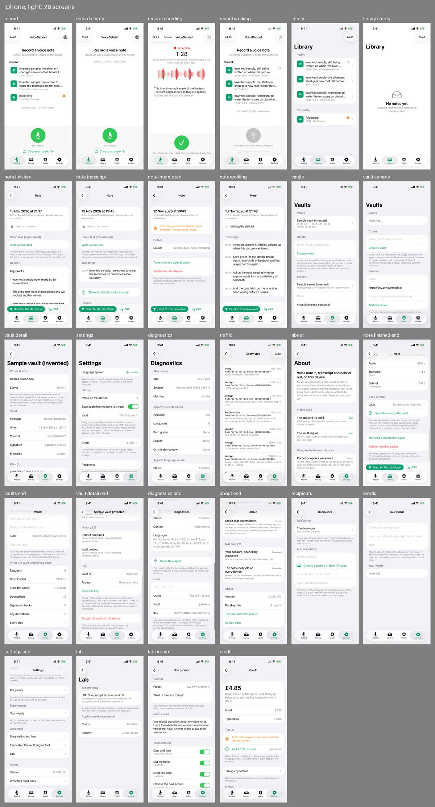
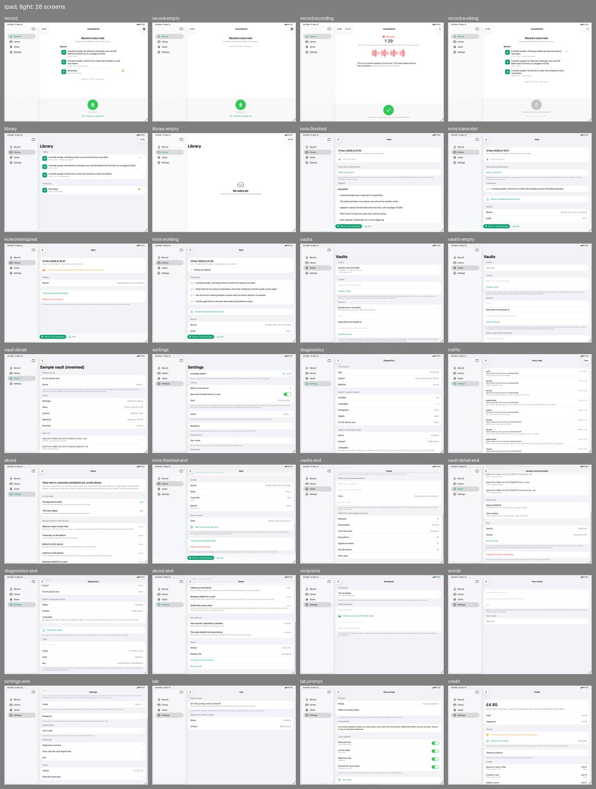

# Review, round 1: the first sight of every screen

13 November 2026. The first time anybody working on this app from a Linux container has seen it.

## The pictures

Run 12 of `screens.yml` on the branch `work/screens`, commit `fb0c548`: 28 pictures in each of four sets (one iPhone in portrait, one iPad in landscape, light and dark), 112 in all, in the artifact `screens-fb0c548566bdf95689a7c201804d807299cc43f4` (kept 30 days). [Build, test and release](../../develop/index.md) says how to fetch them. The app in the pictures is `dev` as it stood that evening: local vaults, recipients and the send bar, the clean text experiment, saving a finished note to a vault, the Lab and credit. The Identity screen was added to the pictures afterwards and is not in this round.

Everything shown is invented sample data. No simulator recorded, transcribed or summarised anything: a recording in progress, a transcript and a debrief are typed-in values.

## Method

1. The agent that built the pictures looked at all four contact sheets and at single screens at full size, and wrote down what is plainly wrong.
2. Four synthetic users, each a separate agent given a persona, a task and only the iPhone pictures that person would see: no source code, no documentation, no other screens. Each said, step by step, what they would tap and what they expected, where they hesitated and where the next picture disagreed.
3. Each thing a user reported was checked against the code before it was written here, because a user who cannot tap guesses what a tap does. Three guesses were wrong and are marked.

## What is plainly wrong, before any user

Seen by the agent, on the pictures alone.

- **On iPad, every list is as wide as the window.** Library, a note, Vaults, Settings, Diagnostics and About run text from one edge of the detail column to the other, about 1,150 points; only the record screen holds its content to a readable width. The [design](../../design/index.md) asks for a readable width everywhere.
- **A Library row wraps badly on iPhone.** The state falls onto a third line ("21:41 · 31.0 s · Writing" then "the debrief"), and a title is cut in the middle of a word.
- **A title is the first twelve words with nothing to say it was cut**: "remind me to water the tomatoes on plot nine before".
- **"Recent" on the record screen shows a time and no day.** Yesterday's interrupted note sits beside today's and reads as today's.
- **"1 lines"** under Transcript in a note's details.
- **The note screen opens with an experiment.** "Clean text (experiment)", a button and three lines of explanation come before the debrief, and "In one sentence", which the design puts first, is last. On an iPhone the first screen of a finished note shows two key points.
- **The send bar covers the note.** It is fixed above the tab bar on every note, including one that was interrupted and has nothing to send but a recording, and one still being written.
- **File paths in a vault break in the middle** ("debriefs/2026/11/13/" then "sample01/audio.wav"), and the audio's type reads "application/octet-stream".
- **The language is shown as a code**, "en-GB", on Settings and in the record screen's toolbar, where a note shows "English (United Kingdom)".
- **Nothing is clipped or overlapping in dark appearance**, and the four tabs become a sidebar on iPad as intended.

## The four users

### Someone who records while driving and has never heard of a vault

Task: record a memo at a red light, stop it, find it later and read the gist, then record a second straight after.

Found the record control at once and liked it. Expected the control to become a red stop; it becomes a green tick lower down, explained by one line of small grey text. Could not record the second memo: the control is grey while the last note is written up, with no word on how long. Opened the finished note expecting the gist first and found a date, "Clean text (experiment)" and then key points cut off by the send bar. Read "£4.85" as paying per memo. Would be afraid of "Send to The developer", the largest button on a private note. Understood none of "vault", "signed commit", "server" at the end of the note, and took them to mean the note was not yet saved. Never saw a way to listen to the memo.

### Someone careful about privacy

Task: before speaking one confidential sentence, find out exactly what leaves the phone, when, to where, and who could read it.

Got clear answers to most of it from the screens: nothing leaves on stop ("Every recording is kept on this device the moment it stops"), sending is always asked for ("Sending to a recipient happens only when you ask", "Nothing is sent without pressing it"), no money is taken and there is no account. Had to infer the rest: that Apple's transcription stays on the phone, that a vault's server cannot read it, and that a note saved automatically to a vault does not go up by itself once that vault has a server. Stopped at "Requests 18, Downloaded 28.4 KB" on a vault that is "On this device only", with no figure for what was sent. Could not tell from a note whether it is already in a vault. Did not know who "The developer" is, which server carries a sent note, or whether the audio goes too.

Would not dictate a confidential note. The deciding thing: a one-tap "Send to The developer" on every note, with nothing on the screen about a confirmation or what is sent.

### A developer who wants to see every request

Task: see every request the app makes, to the network and to the model, in enough detail to check the app's claims.

Found the log ("Every step the vault engine took") and judged its decryption rows the best thing in the app: cipher, key, iv and tag sizes and the bytes before and after, which add up. But a request row reads "GET folder, not cached (mutable)" with a size and "0 ms": no host, no status, no clock time, nothing to say what caused it, so a real request would look the same as a read from the device. Sending a note has no description on the wire and no visible entry in any log. Requests to the model can be seen only in the Lab; a debrief's "One request" cannot be opened. The promise that `sgit clone` and the key open the same vault gives no command. "Machine arm64" is not a device.

### Someone who lost a recording in another app

Task: decide whether to trust this one with a 40-minute recording.

Was convinced by the words on the recording screen ("Saved to this device as you speak. If the recording is cut short, what was said is kept.") and by finding the interrupted note listed with a warning in two places. Was not convinced by the note itself: "The recording is kept", and no way to play it or see how long it is. No play control on a finished note either. Found the promise only while recording, not before pressing record. Read "Save each finished note to a vault" as not covering the interrupted one, and saw that the vault is "On this device only", so the second copy is on the same phone. Worried by "Discard" in the top bar while recording and by "Delete from this device" directly under the button to run a note again.

Would not trust it. The deciding thing: a recording said to be kept that cannot be played or measured.

## Findings

Most serious first. "Who" is D (driver), P (privacy), V (developer), L (lost a recording), A (the agent). The owner is the session whose brief covers that screen.

| # | Screen | Who | Finding | Owner | Status |
|---|---|---|---|---|---|
| 1 | `note.interrupted`, `note.finished` | L, D | A recording is said to be kept and cannot be played, and an interrupted one shows no length. Two of four users would not use the app for this alone | main session | open, issue 029 |
| 2 | `record.working` | D, L | No new recording can start while the last note is being written up: the control is grey, with no word on how long. This is against "never lose a recording" | main session | open, issue 030 |
| 3 | every note | P, D, L | "Send to The developer" is the most prominent control on every note, including an unfinished one. The owner asked for the bar (issue 026) and it stays; what the screen does not say is that it asks first, who the developer is, or whether the audio goes. It decided the privacy user against the app | main session | open, issue 031 |
| 4 | `record`, `library` | D, L, P | A balance, "£4.85", sits in the top bar of the first screen and goes down, with nothing beside it to say that no money is taken. Three users read it as paying per memo | credit session | open, issue 032 |
| 5 | `traffic`, `vaults-end` | V, P | The log cannot tell a request to a server from a read on the device: no host, status, time or cause. The totals call local reads "Requests" and "Downloaded" on a vault that is on the device only, and have no figure for what was sent | vaults session | open, issue 033 |
| 6 | `note.finished` | D, A | The gist is not first. A date, then an experiment, then key points cut off by the send bar; "In one sentence" is last | main session | open, issue 034 |
| 7 | all lists on iPad | A | Lists are as wide as the window on iPad | main session, vaults session | open, issue 035 |
| 8 | `record`, `library`, `settings` | D, L, A | States with no next step or no day: "Not finished" and "Transcript only" explain nothing; Recent shows no day; the automatic save says "finished note" and is silent on an interrupted one | main session | open, issue 036 |
| 9 | `vaults`, `vault.detail`, `note.finished-end` | D, P, L | A person who has never met a vault cannot tell what one is for, whether a note is in one, or whether notes saved automatically go to a server once the vault has one. The server form's filled-in address looks like a second saved server | vaults session | open, issue 037 |
| 10 | `record.recording` | D | The control to finish is a green tick in a different place from the record control, explained by one small line. Decided by the owner in issue 022; recorded here because the first user to meet it expected a red stop | main session | open, no issue: the owner's decision, to be watched on a device |
| 11 | `note.finished-end`, `lab` | V | Requests to the model are visible only in the Lab; a debrief's own request cannot be opened | lab session | open, covered by issues 013 and 020 |
| 12 | `vault.detail-end` | V | "sgit clone followed by this key" gives no command, and holds only once the vault is on a server | vaults session | open, with issue 037 |
| 13 | `diagnostics` | V, A | "Machine arm64" is not a device model; the language is a code in two places and a name in a third | main session | open, with issue 036 |
| 14 | `library`, `vault.detail`, note details | A | Rows that wrap or cut badly: the Library row's state, a title cut mid-word and after twelve words, file paths, "1 lines" | main session, vaults session | open, with issues 035 and 036 |
| 15 | the pictures themselves | D, P, V, L | What a round could not see: no picture of any confirmation, of a note opened from the record screen, of the Lab after a run, or of a server with a vault on it | screens session | open, issue 038 |
| 16 | `note.working` | D | "Stopping throws me onto the Library tab." In the app the note opens on the Record tab; the pictures show note screens under Library | screens session | not a fault: an artefact, to be removed under issue 038 |
| 17 | `vaults`, `vault.detail`, `vault.detail-end` | P, V | The same vault has a different id, head and time on different screens | screens session | not a fault: each picture is a separate launch, and the sample vault's key is made at random each time so that no key is ever in the source |
| 18 | `settings`, `library` | L | "Notes on this device 3" against four in Library | screens session | not a fault: the two pictures use different sample notes |
| 19 | `record`, `library` | D, L | The same note's time differs by a minute between screens | screens session | not a fault: separate launches |
| 20 | every note, `note.interrupted`, `record.recording` | P, L | "No confirmation before sending, deleting or discarding." The code asks before each of the three; no picture shows it | screens session | not a fault in the app; the missing pictures are in issue 038 |
| 21 | `diagnostics` | V | The speech model reports no languages while a note has a transcript | screens session | not a fault: a simulator has no speech model, and the transcript is sample data |

## What worked

Said without being asked, by the users it applies to: one large record control found at a glance; the red timer with "Saved to this device as you speak"; the Library named by first words under "Today"; an interrupted note that is listed and marked rather than hidden; sending that says it is never automatic; "simulated" and "Proposed" written wherever something is not real; and a log whose decryption rows can be checked by arithmetic.
