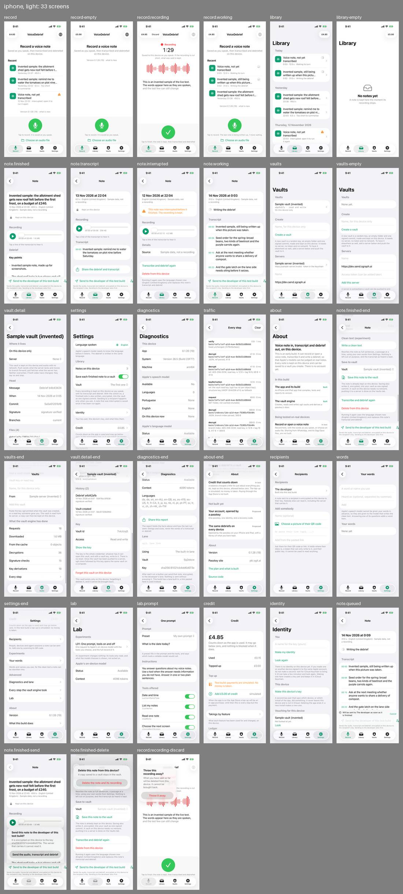
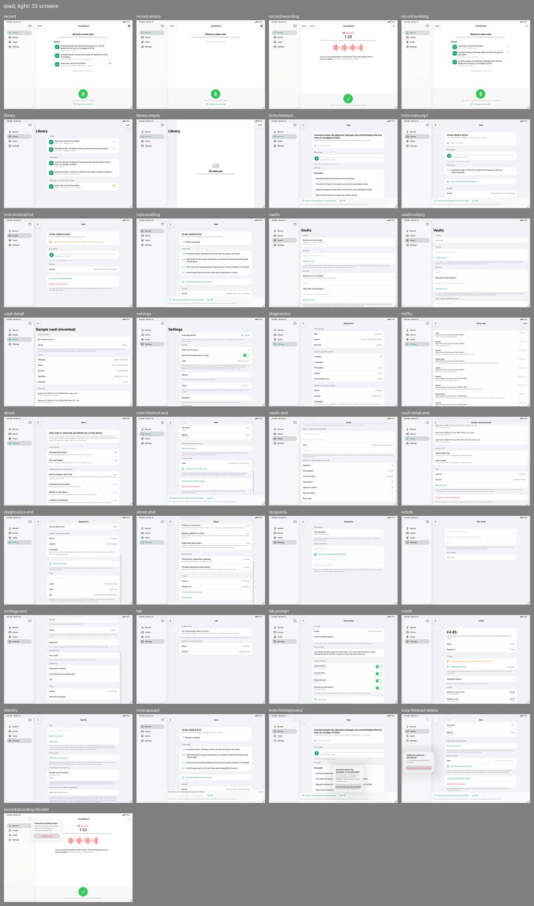

# Review, round 2: what the fixes changed

14 November 2026. The same four users, the same tasks, new pictures, after the fixes that followed [round 1](../round-1/index.md).

## The pictures

Run 19 of `screens.yml` on the branch `work/screens`, commit `4338ea2`, which holds `dev` up to `6475ff7`: 33 pictures in each of four sets, 132 in all, in the artifact `screens-4338ea2367dc8a9c4495c5b3d5257302f23aacce`. Everything shown is invented sample data, as before.

What the pictures can show now that they could not in round 1:

- **What the app asks first.** Three pictures taken after a tap: the confirmation before sending, before deleting and before discarding.
- **A send pressed early.** A note still being written up whose send was pressed: it waits.
- **A queue.** One note being written up and one waiting its turn, with the record control live.
- **Recordings as long as they say.** Each sample note's audio is silence of the length the note claims, so the player has something true to show.
- **A note being made is on the Record tab**, where stopping a recording leaves it.

## Method

As round 1: the agent first, then four synthetic users, each a separate agent given a persona, a task and only the iPhone pictures that person would see. None was told what round 1 found or what had changed. Each was told that every picture is a separate launch, so that the artefacts of round 1 (times a minute apart, a vault with a different id in each picture) were not reported again. What a user reported was checked against the code before it was written here.

## Did the four users change their minds?

| User | Round 1 | Round 2 |
|---|---|---|
| Records while driving | The second memo was blocked: the control was grey | Not blocked. Read "1 more waiting" and understood there was no need to wait. Still loses a tap, because stopping opens a note |
| Careful about privacy | Would not dictate a confidential note | **Would**, without pressing Send or adding a server. Decided by "Nothing is sent without pressing it" and the vault saying "On this device only" |
| Wants to see every request | Blocked: the log shows no host, status, time or cause | The same. Nothing in the log or the Lab changed |
| Lost a recording elsewhere | Would not trust it: a recording said to be kept could not be played | Trusts it to capture: the interrupted note shows a player and "00:00 of 02:12 · 4.2 MB". Would still not make it the only home of a recording, for a new reason: no copy off the phone that an ordinary person can make |

## Round 1's findings, one by one

| # | Round 1 finding | Round 2 | Status |
|---|---|---|---|
| 1 | A recording cannot be played; an interrupted one shows no length | A player on every note with audio, with its length and size, and a line of the transcript plays from that moment. Seen on `note.finished`, `note.transcript`, `note.interrupted` | fixed (issue 029) |
| 2 | No new recording while the last note is written up | The record control stays green; the caption says "The last note is being written up, 1 more waiting"; a waiting note's row says "Waiting its turn". Seen on `record.working`, `library` | fixed (issue 030) |
| 3 | "Send to The developer" is the most prominent control and says nothing about itself | Now "Send to the developer of this test build", outlined instead of filled, with a line beneath: what goes, that it is encrypted to the recipient's key, that sending to the developer asks first. The confirmation is pictured and names the key. Not shown on an interrupted note. What is left is in the new findings | fixed in the main; the rest stays in issue 031 |
| 4 | "£4.85" on the first screen reads as paying per memo | Unchanged. All three users who see the record screen reported it again | open (issue 032) |
| 5 | The log cannot tell a server from the device; local reads are "Requests" and "Downloaded" | Unchanged: "Requests 18, Downloaded 1.6 MB" on a vault that needs no network. The privacy user noticed that 1.6 MB is the size of the recording | open (issue 033) |
| 6 | The gist is not first on a note | The one sentence is the note's heading, with the date beneath; the clean text experiment has moved below the transcript. The send bar still covers the key points on an iPhone | fixed (issue 034); the bar is a new finding |
| 7 | Lists as wide as the window on iPad | A note, the Library, Settings, Diagnostics, About, Recipients, Credit and the Lab are held to a readable width. The Vaults screens and the log are not yet | fixed in part (issue 035, the vaults session) |
| 8 | States with no next step or no day | Rows read "Interrupted: open it to run it again", "Too short to summarise", "Waiting its turn"; Recent says "Yesterday"; the record screen says "Saved as you speak" before recording; Settings says a note that was interrupted is saved once it has been run again | fixed in the main (issue 036); small things remain |
| 9 | A vault, for someone who has never met one | Unchanged. Both non-technical users again read the end of a note as a doubt about whether it is saved | open (issue 037) |
| 10 | The control to finish is a green tick | Unchanged, and the driver expected a red stop again | open, the owner's decision |
| 11 | Requests to the model are visible only in the Lab | Unchanged | open (issues 013, 020) |
| 12 | "sgit clone followed by this key" gives no command | Unchanged | open (issue 037) |
| 13 | "Machine arm64"; the language as a code | The language is named everywhere. "Machine arm64" remains, and may be the simulator | fixed in part |
| 14 | Rows that wrap or cut badly | "1 line" is right; a cut title ends with an ellipsis. In the Library a title is still cut in the middle of a word ("pictu…", "plot ni…") where Recent cuts at a word, and an interrupted row's state runs to a third line | fixed in part |
| 15 | What the pictures could not show | The confirmations, a queued send, a queue of notes and a note on the Record tab are pictured. Not yet: the Lab after a run, a vault with a server, a recipient added by hand, portrait on iPad, the largest text size | fixed in part (issue 038) |
| 16 | Artefact: a note being made shown under Library | Removed: it is pictured on the Record tab | fixed |
| 17 to 19 | Artefacts of separate launches | Still so; the users were told, and did not report them | not a fault |
| 20 | "No confirmation before sending, deleting or discarding" | The three confirmations are pictured, and the users read them | fixed, and see new finding 3 |
| 21 | Artefact: no speech model on a simulator | Still so | not a fault |

## New findings

Most serious first. "Who" is D (driver), P (privacy), V (developer), L (lost a recording), A (the agent).

| # | Screen | Who | Finding | Owner | Status |
|---|---|---|---|---|---|
| 1 | `note.finished-end`, `vaults` | L | There is no plain way to get a recording off the phone. A note's words can be shared; its audio cannot be exported or saved to Files. The only other copy is a vault "On this device only", and the route beyond that is a form asking for a server address and an access token. It decided this user against keeping a recording only here | main session; vaults session | open, issue 039 |
| 2 | `diagnostics-end` | P, V, A | The "Lane" section on Diagnostics says a link pasted there "is used instead" of the built-in one when a note is sent. Checked in the code: since recipients replaced the lane section on a note, nothing reads that link. A screen says the app does something it does not | main session | open, issue 041 |
| 3 | `note.finished-send`, `note.finished-delete`, `record.recording-discard` | L, P, D | Each confirmation shows one button, the destructive one, and no visible way to back out. The code gives each a Cancel; the pictures do not show it, and three users said they could not see how to say no | main session | open, issue 040 |
| 4 | `note.finished-send` | P, V | The confirmation names the key and not the server that carries the note, nor who "the developer" is, how long it is kept or whether it can be taken back | main session | open, with issue 031 |
| 5 | `note.finished`, `note.queued` | D, P, A | The send bar and its two lines of small print take about a fifth of an iPhone screen and cover the key points; the "Add" control beside it is cut off at the right edge, leaving half an icon | main session | open, with issue 031 |
| 6 | `settings`, `note.finished-end` | P, L | "Save each finished note to a vault" is on by default and does not say there that the vault is on this phone, nor whether a vault that has a server sends by itself. A note does not say whether it is already in a vault; neither does the confirmation before deleting, which says only that "a copy saved to a vault stays" | vaults session; main session | open, with issue 037 |
| 7 | `note.working`, `record.working` | D | Stopping opens the note, so a second memo straight after costs a small tap at the top corner first. The owner asked for the note to open at once; recorded for a driver | main session | open, no issue: the owner's decision, to be watched on a device |
| 8 | `note.queued` | P | A send pressed early goes the moment the note is finished, before its debrief has been read. It is what issue 026 asks for; the screen says "Will be sent to The developer as soon as it is finished" and offers Cancel | main session | not a fault: a decision. The capital in "The developer" is a slip |
| 9 | `record.working`, `library` | L, A | A time just after midnight prints as "0:03" beside "12.0 s" and reads as a length. Lengths are "49.0 s" in a row and "00:49" in the player | main session | open, with issue 036 |
| 10 | `note.interrupted` | L, D | "Transcribe and debrief again" on a note that was never transcribed; "replaces this note's transcript and debrief" made one user fear for the recording; "Tap a line of the transcript to hear it" where there is no transcript; the row in a list shows no length though the note has one | main session | open, with issue 036 |
| 11 | `about`, `identity` | P | No one place lists everything that can leave the phone. "There is no account yet" on About sits beside "the same Apple account" and iCloud Keychain on Identity; device backups are not mentioned anywhere | main session; identity session | open, with issue 037 |
| 12 | `record.recording` | L | Nothing says how much has been saved so far: a timer shows that time passes, not that the file grows | main session | open, with issue 036 |

## What worked

Unprompted, in round 2: "Saved as you speak" before the first recording; "If the recording is cut short, what was said is kept"; the interrupted note with a player and its length; "1 more waiting" under a live record control; a note that opens with its one sentence in bold; a confirmation before sending that names the key, which the developer matched against the fingerprint on Diagnostics; and "Throw this recording away? It cannot be brought back", which the least trusting user called honest.
