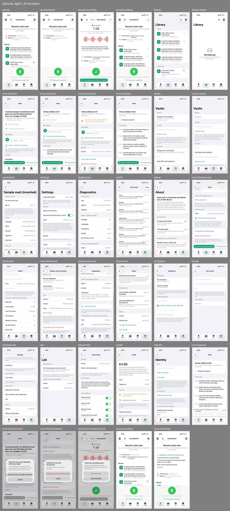
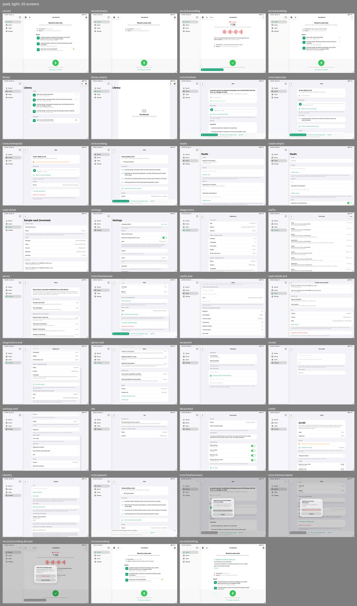

# Review, round 3: a memo that goes to somebody

14 November 2026. The four users of [round 2](../round-2/index.md) again, and a fifth for what is new: finishing a recording and sending it in one press.

## The pictures

Run 37 of `screens.yml` on the branch `work/screens`, commit `7c323cc`, which holds `dev` at v0.1.36: 35 pictures in each of four sets, 140 in all, in the artifact `screens-7c323cc2c1b1c2b610f9cf49bc7fc4e2854cf14e`. Everything shown is invented sample data, as before.

What is pictured for the first time:

- **Finish and send.** While recording, "Finish and send to Maria (invented)" under the tick, for a recipient the sample world adds.
- **Where the work happens.** The two lines on the record screen, "On this device" and "Network", in four states: idle, recording, writing a debrief, and sending ("Sending to Maria (invented), part 2 of 5, encrypted").
- **The briefing on opening.** "Updated to v0.1.36: see what is new", new notes, an interrupted one, a note sent.
- **A note that was sent.** "Sent to Maria (invented), 5:07" on the note, and "Sent to Maria (invented)" on its row.
- **A way to say no.** The three confirmations are alerts now, each with "Cancel" or "Keep recording".
- **The version badge and the test credit**, at the top of the record and library screens.

Not pictured: the record screen in the moment after "Finish and send" is pressed, with its card "Your last note will be sent to ... as soon as it is written up". It needs a real recording to be stopped, which a sample launch does not have.

## Method

As before: the agent first, then the synthetic users, each a separate agent given a persona, a task and only the iPhone pictures that person would see, with no source and no account of earlier rounds. The fifth user runs a small team and dictates memos for one colleague, ten times a day, walking, with one hand; the task was to get a memo to Maria in the fewest taps, send a second, and an hour later find out which went. What a user reported was checked against the code before it was written here.

## What the five users decided

| User | Round 2 | Round 3 |
|---|---|---|
| Records while driving | Not blocked; loses a tap because stopping opens a note | The same, and a new fear: "Finish and send to Maria" a thumb's width under the tick, in a cradle |
| Careful about privacy | Would dictate a confidential note | **Would not, for now.** Decided by one thing: a press beside the finish button that sends a recording to a person and shows no question first. Everything else read better than before: "Network: Not in use: nothing is leaving this device" was called exactly what was hoped for |
| Wants to see every request | Blocked: the log shows no host, status, time or cause | The same. The network line on the record screen is new and welcome, and leads nowhere: "part 2 of 5" cannot be opened |
| Lost a recording elsewhere | Trusts it to capture; would not make it the only home of a recording | **Would trust it with a 40-minute recording, cautiously.** Decided by the interrupted note's player and "Share or save the recording". One sentence in Settings nearly reversed it (new finding 7) |
| Sends memos to a colleague (new) | | Two taps from thought to Maria, with her name on the button. Cannot tell afterwards, from a list, a memo that is waiting to go or failed to go from one never sent |

## Round 2's new findings, one by one

| # | Round 2 finding | Round 3 | Status |
|---|---|---|---|
| 1 | No plain way to get a recording off the phone | "Share or save the recording" on every note with audio, with a line saying it leaves the device unencrypted. The user who asked for it found it, understood it and would use it. A copy off the phone through a vault still needs a server and a token | fixed (issue 039); the vault half stays with issue 037 |
| 2 | Diagnostics describes a pasted lane that nothing uses | Gone. Diagnostics shows the built-in lane's vault and key as facts; the developer matched the key against the one in the confirmation | fixed (issue 041) |
| 3 | A confirmation shows no way to back out | Each is an alert with two buttons: "Cancel" beside sending and deleting, "Keep recording" beside "Throw it away". All who saw them read them | fixed (issue 040) |
| 4 | The confirmation names the key and not the server or the developer | It now says "The server that carries it cannot read it", and still names neither the server nor who the developer is, how long a note is kept or whether it can be taken back | unchanged (issue 031) |
| 5 | The send bar covers the key points; "Add" is cut off | The bar is one row and one line of small print. The second button, "Send to the developer (test)", is cut at "Send to the d", and four users reported it | fixed in part (issue 031) |
| 6 | The switch that saves to a vault does not say the vault is on this phone; a note does not say whether it is in a vault | The switch is unchanged. A note that was saved now says so in the code ("Saved to the vault ..., time"); the sample note is not saved that way, so it is not pictured. The confirmation before deleting is unchanged | unchanged in the pictures (issue 037) |
| 7 | Stopping opens the note, so a second memo costs a tap | "Finish and send" stays on the record screen. The plain tick still opens the note | fixed for a memo that is sent; otherwise the owner's decision |
| 8 | A send pressed early goes before the debrief is read | A decision, as before. "Will be sent to The developer" keeps its capital | not a fault; the capital is still a slip |
| 9 | "0:03" beside "12.0 s" reads as a length | Times are "05:01" now. Two users still read "05:00 · 49.0 s" as five minutes | fixed in part (issue 036) |
| 10 | The interrupted note: "again" on a note never transcribed; no length in its row | The button says "Transcribe and debrief". The row still shows no length, and on the record screen is cut at "Interrupted: open" | fixed in part (issue 036) |
| 11 | No one place lists everything that can leave the phone | Unchanged. The privacy user assembled the list from seven screens | unchanged (issue 037) |
| 12 | Nothing says how much has been saved so far | Unchanged | unchanged (issue 036) |

Of the twelve: three fixed, four in part, four unchanged, one a decision. From round 1, still open and reported again: the log that cannot tell the device from a server and counts local reads as "Requests 18, Downloaded 1.6 MB" (issue 033); a vault, for someone who has never met one (037); the green tick to finish, where the driver expected a red stop; requests to the model visible only in the Lab (013, 020).

## New findings

Most serious first. "Who" is D (driver), P (privacy), V (developer), L (lost a recording), M (sends memos), A (the agent).

| # | Screen | Who | Finding | Owner | Status |
|---|---|---|---|---|---|
| 1 | `record.recording` | P, D, L, M | "Finish and send to Maria" sits directly under the tick, is the only control there with words on it, and sends with no question. Three users feared pressing it by mistake; for the privacy user it decided against the app. The fifth user has the opposite trouble: the large round control is the one that does not send. Checked in the code: the send is held until the note is written up and can be cancelled, but only by opening that note; the card on the record screen offers "Dismiss" and nothing else. One press is what issue 026 asks for and stands; what is missing is a way back from where the press was made | main session | open, issue 043 |
| 2 | `record.working`, `library`, `record-briefing` | M, A | A send that has not gone is invisible, and can be lost. Checked in the code: a send waiting for its note, and the queue of sends, are held in memory only. If the app is closed before the note is written up, the send is forgotten and nothing says so. A send that fails is shown on that note's bar until the next send starts, and nowhere else. No row says "waiting to be sent", "sending" or "could not be sent"; the briefing has a line for a note that could not be saved to a vault and none for one that could not be sent. The app's own rule is never to lose a recording; a memo whose point is to reach somebody needs the same for its send | main session | open, issue 043 |
| 3 | `note.finished` | M | "Send to Maria" stays green on a note that says "Sent to Maria (invented), 5:07". Checked in the code: pressing it sends a second copy at once, with no question, and charges for it | main session | open, issue 043 |
| 4 | `record`, `library` | D, P, V, L, M | Two symbols with no words at the top of the record and library screens: test tubes and a sparkle. All five users said they did not know what they do. Checked in the code: they are "Test credit £4.85" and the version, both written as a symbol with a title, and the bar draws only the symbol on an iPhone. The amount that three users misread in rounds 1 and 2 is gone, and so is the explanation. While recording, "Discard" sits between them | main session; credit session | open, issue 044 |
| 5 | `settings` | L | "A note that was interrupted is saved once it has been run again." It is about the vault. The user who lost a recording read it as "an interrupted recording is not saved", against "The recording is kept" on the note, and said it nearly decided them | main session | open, issue 045 |
| 6 | `about-end` | P, A | The status screen says of vaults: "The vault's key is kept on this device only." Since v0.1.33 vault keys are kept in iCloud Keychain as well unless a switch is turned off, and `vault.detail-end` says "In iCloud Keychain, on your devices". A screen of the app says something the app no longer does | main session; vaults session | open, issue 045 |
| 7 | `library`, `record`, `record-briefing` | M | A row says "Sent to Maria (invented)" and not when: "05:01" on the row is when it was recorded, and "5:07" is inside the note. The briefing says "Sent 1 note to Maria (invented)" and not which. "Sent" means it left this phone; nothing says it arrived | main session | open, with issue 043 |
| 8 | `record.sending` | M, V, P | The network line names who and not which note; "On this device: Nothing running" above "Network: Sending" reads as a contradiction; "part 2 of 5" is not explained, and the developer could not find the five parts in the log of every step | main session | open, with issues 020 and 027 |
| 9 | `note.finished`, `note.working` | P, D, L, M | "The developer asks first." Two users read it as the developer asking them something. It also tells a careful reader that the other button does not ask | main session | open, with issue 031 |
| 10 | `record-briefing` | D, M | The line about the update comes first and the card pushes "Recent" almost off an iPhone screen; a person opening the app for their notes has to dismiss it or scroll | main session | open, with issue 025 |
| 11 | `note.finished-delete` | L, P | "A copy saved to a vault stays in the vault" does not say whether this note has such a copy, or that a copy already sent stays with whoever has it; the discard alert says "It cannot be brought back" and this one does not | main session | open, with issue 037 |
| 12 | `recipients`, `vaults` | P | The developer is a recipient nobody added and cannot be removed; the server field on the Vaults tab is already filled with an address, and the user could not tell an example from a setting | main session; vaults session | open, with issues 031 and 037 |
| 13 | `record.recording` on iPad | A | On an iPad in landscape "Finish and send" is at the left edge of the window, far from the tick in the middle | main session | open, with issue 043 |
| 14 | `record` and all | D | "Debrief" is not this user's word for a summary | the owner | not a fault: the product's name. Recorded because a driver said it twice |
| 15 | `diagnostics` | V | "Apple's speech model: Available No, Languages 0" beside a record control that is live | | not a fault: a simulator has no speech model, and the sample launch says which language to show |

## What worked

Unprompted, in round 3: one large microphone at thumb height; "It is saved as you speak" and "If the recording is cut short, what was said is kept"; "Network: Not in use: nothing is leaving this device" on the first screen; the briefing's "1 note was interrupted: its recording is kept", which the least trusting user called the best line in the app; a recipient's name written on the button, so a memo cannot go to the wrong person; "Sent to Maria (invented), 5:07" on a note, "exactly the sentence I want"; recording the next memo while the last is written up; and, for the developer, the lines of the log that can be checked by arithmetic ("AES-256-GCM, read key, iv 12 B + tag 16 B, 69 B -> 41 B").
