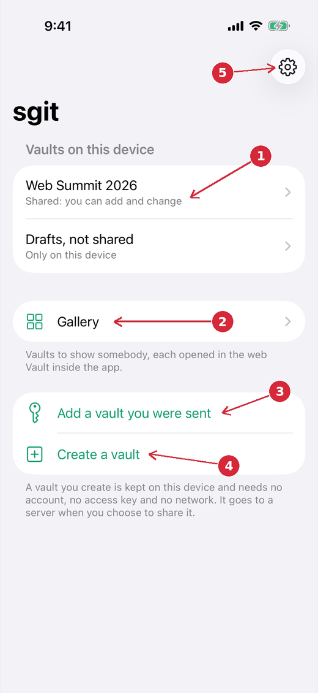
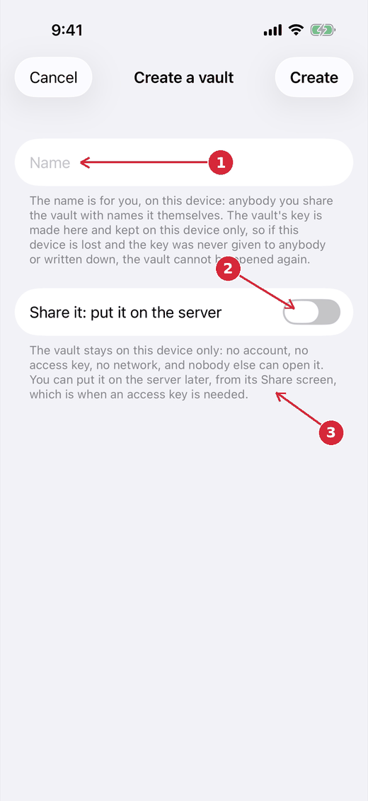
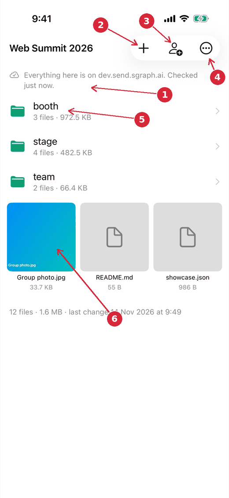
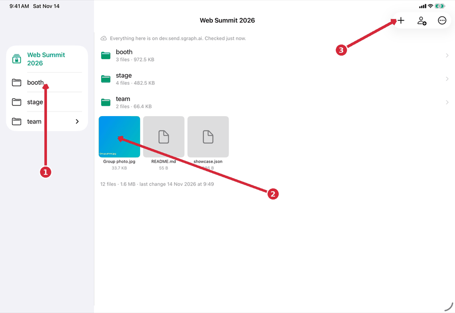
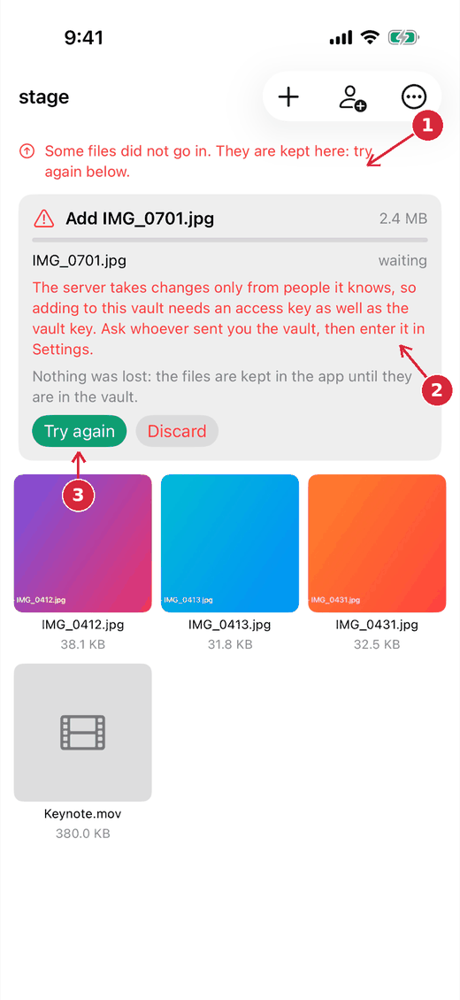
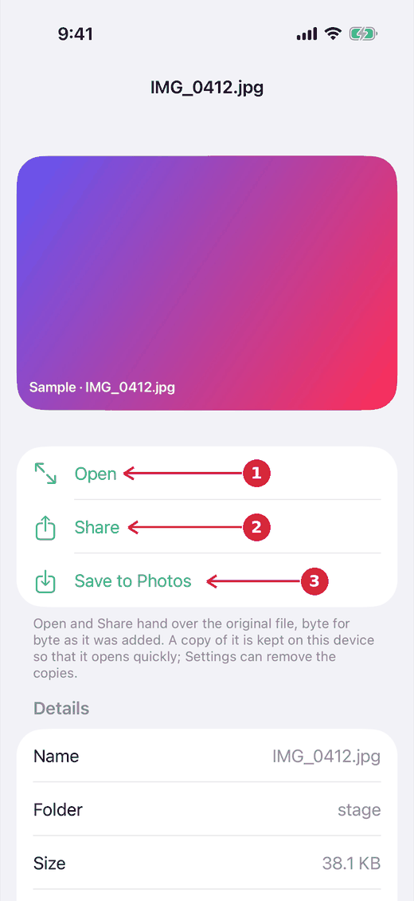
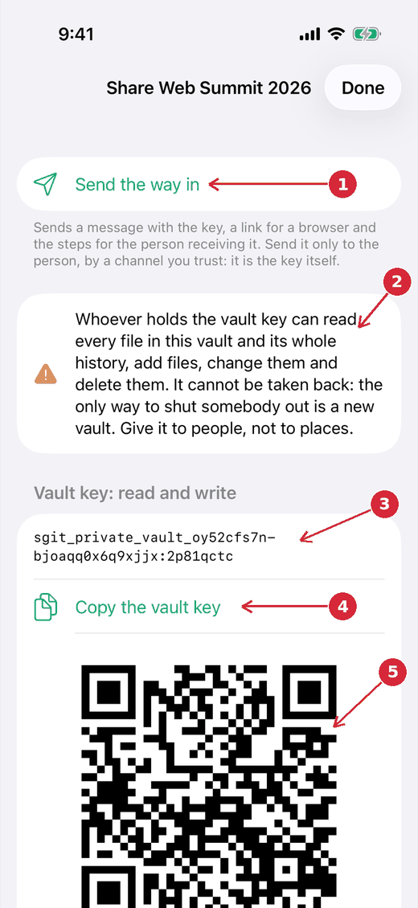
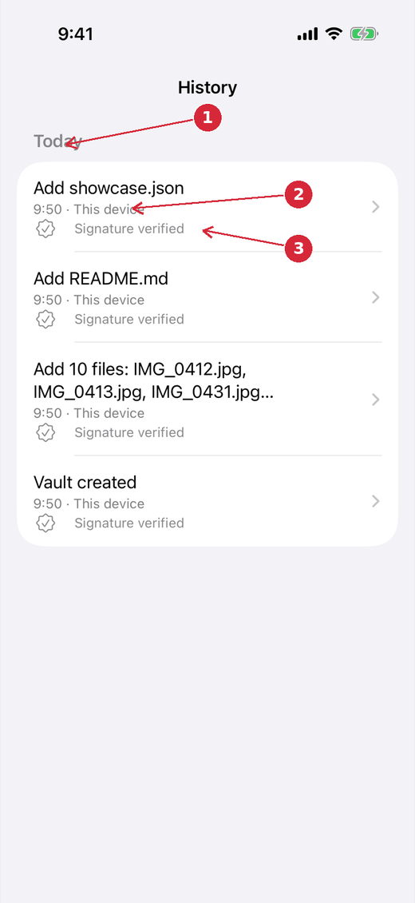

# The sgit app: a guide in pictures

What the sgit app (SGit Vaults) does today, screen by screen, with the things to press numbered on each picture. [What is built](../built/index.md) is the reality file and says how each part was tested; [the design](../design/index.md) is the intention; [the first review](../reviews/round-1/index.md) is what three synthetic users made of it.

Read this first, because it limits everything below: **the pictures were taken by CI on a simulator, with an invented vault made by the app's own engine and no server.** The app compiles, its tests pass, and builds go to TestFlight from every green push to `dev`. The owner has opened one build on a Mac and seen two screens. Nothing else here has been used by a person on a device, and the app has not yet spoken to the real server. Where a step has never been tried by hand, the text says so.

## The idea in four sentences

A vault is a folder of files with a history. Every file is encrypted on the device before it goes anywhere, so the server stores only ciphertext. Whoever holds the vault's key can open it, in this app, in the `sgit` command on a computer, or in the web Vault in a browser: it is one format. The app keeps nothing of ours: there is no account and no backend, only the vault server.

## 1. The first screen: your vaults

1. **A vault, and where it stands.** "Shared: you can add and change" means it is on the server and this device holds its full key. "Only on this device" means it has never been sent anywhere.
2. **Gallery.** A list of vaults to show somebody, each opened in the web Vault inside the app. It is empty until a showcase vault or links are given to it (issue 107).
3. **Add a vault you were sent.** Paste a vault key, a read key or a link, or scan a QR code.
4. **Create a vault.** Made on this device, with no account, no access key and no network.
5. **Settings.** The server, the access key, this device's signing key, the photo conversion switch and the cache.

## 2. Creating a vault

1. **The name is yours.** It is kept on this device; anybody you share the vault with names it themselves.
2. **Share it: put it on the server.** Off for a person with no access key, so that creating a vault never stops at a wall. It can be sent to the server later, from its Share screen.
3. **What that costs.** Sending a vault to the server needs an access key, which is a pass given out by whoever runs the server. It is not a key to any vault.

The vault's key is made here and kept in this device's Keychain. If the device is lost and the key was never given to anybody or written down, the vault cannot be opened again. The sheet says so.

## 3. Inside a vault

1. **Where everything stands.** One line at the top of every folder: on the server and when that was last checked, on this device only, how many files are on their way in, or that some did not go in. Pull down to check again.
2. **Add.** Photos and videos from the library, files from Files, or a new folder. Each selection becomes one signed commit.
3. **Share.** Opens the sheet in section 6.
4. **More.** History, refresh, grid or list, and "Save these N files to Files", which takes the whole folder out as the originals.
5. **A folder.** Its file count and size. Tap to go in.
6. **A file.** Tap to open it. On a Mac or an iPad with a pointer, files can be dragged out to the desktop and dropped in (written, never tried by hand).

### On an iPad or a Mac

1. **The folder tree.** As in the web Vault: the folders on the left choose what is shown on the right.
2. **The open folder.** The same grid or list as on a phone.
3. **The same three buttons.** The app is one codebase: iPhone, iPad and Mac show the same screens and can do the same things. What they do not do yet is keep each other up to date on their own: each device reads the vault from the server when it is opened or refreshed.

## 4. Adding files, and what happens when it is refused

A selection is copied into the app first, so it is safe the moment the picker closes. It is then encrypted, sent, and committed. Files larger than 4 MB go up in parts and can carry on after an interruption. A file is never shown as in the vault before its commit has been pushed and read back.

1. **The standing line turns red** when something did not go in.
2. **Why.** Here, the server refused because this device has the vault key and no access key. This is the open question in issue 110: a teammate who is sent a vault key cannot add to the vault until they also have an access key. The owner decides how they should get one.
3. **Try again.** Nothing was lost: the file is kept in the app until it is in the vault, or until it is discarded.

## 5. A file

1. **Open.** Full screen, with the system's viewer: images, video, PDF, text and whatever Quick Look can show.
2. **Share.** Hands over the original file, byte for byte as it was added.
3. **Save to Photos.** For images and video.

Not built: editing a file in the app, and a preview of an HTML page as the web Vault shows it. Both are next (see the end of this page).

## 6. Sharing a vault

1. **Send the way in.** One message with the steps for the person receiving it, the key, and a link that opens the vault in a browser.
2. **The warning.** Whoever holds the vault key can read everything, add, change and delete, and it cannot be taken back. A read key, lower on the sheet, can only look.
3. **The key itself**, shown only when asked for.
4. **Copy.** The copy stays on this device and expires from the clipboard after two minutes.
5. **A QR code** of the key, for a device beside this one. Below it: a link for a browser, and the line to paste on a computer (`pip install sgit-ai && sgit clone`) to get every file and the whole history.

There is no way yet to give somebody access that can be taken back (issue 104), and no way to give "may add, may not delete".

## 7. History

1. **Grouped by day.**
2. **Who.** "This device" or "Another device", told apart by the key that signed the commit. A device cannot yet carry a name (issue 112): that needs a decision on where a name lives in a vault.
3. **The signature.** Every commit this app makes is signed with a key that never leaves the device, and every commit it reads is checked.

Tap a commit to see what it added, changed and removed.

## How it came to be, in order

1. **13 November 2026.** The owner asked for sgit as a native app, starting with photos, videos and large files for the team. The engine gained large files (streamed encryption, upload in parts, resume), proven against the `sgit` command in both directions in CI.
2. **The first build** reached TestFlight as 0.1.19. The owner opened it on a Mac and met a wall: creating a vault demanded an access token.
3. **Local first.** Creating a vault now needs nothing; sending it to a server is a later, separate step. Drag and drop and the folder tree were added at the owner's request.
4. **Pictures.** A CI job photographs every screen on an iPhone and an iPad. The first pictures showed two faults nobody had seen, which were fixed.
5. **The gallery** (0.1.39), at the owner's request.
6. **The first review** by three synthetic users, from the pictures, found seventeen things. Fixed since: the standing line, a visible Share that leads with the action, the Create sheet, rows in words, saving a folder out, history by day, the refusal's wording, large text. Left for the owner: issues 110, 104, 112.
7. **Now: 22 pictures per device**, including dark appearance, large text and a refused upload.

## What is next

Asked for by the owner on 14 November 2026, none of it built yet:

- the whole web Vault opened inside the app on the vault you are looking at, so that everything it can do is one tap away;
- a simple edit of a text file, and an HTML preview, natively;
- a record of every action in the app, on every device, that the owner can send to the people building it;
- a button to speak a message to the people building it, and an inbox for the reply;
- a first use of Apple Intelligence;
- regular builds for external testers, each with a plain account of what is new.
