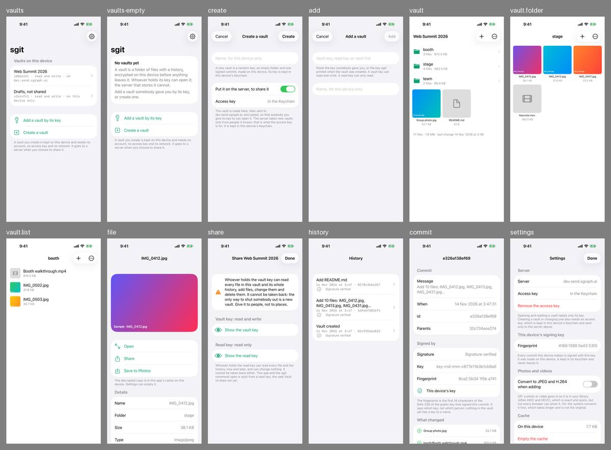
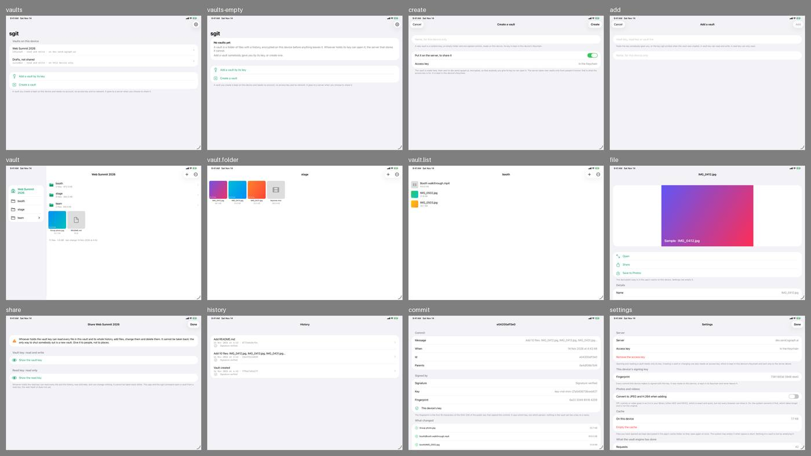

# The sgit app, review round 1: three people who were sent a key

14 November 2026. The first reading of the sgit app's screens by people who did not build it. The method is the one used for [VoiceDebrief's screens](../../../reviews/index.md); what the app is meant to be is on [its design page](../../design/index.md), and what exists on [its reality file](../../built/index.md).

## The pictures

Run 4 of the workflow `sgit app screens`, at commit `695fd02` on the branch `work/sgit-app-share`: twelve screens on one iPhone and one iPad, light appearance, in the artifacts `sgit-screens-iPhone` and `sgit-screens-iPad`. The run asked for, on `dev` at `0b4852a`, was still waiting for a Mac; the screens' code is the same in the two commits (no file under `Apps/SGit/Sources/UI` differs), and the three layout fixes that followed the first pictures are in both. Everything shown is an invented vault in temporary folders.

## Method

The agent looked first. Then three synthetic users, each a separate agent given a persona, a task and only the iPhone pictures that person would see: no source code, no documentation. Each said what they would tap and what they expected, where they stopped and where the next picture disagreed. What they reported was checked against the code before it was written here; where a user guessed at a screen that was not pictured, the code says what is really there and this page says so.

## What is plainly wrong, before any user

- **The Create sheet is pictured in one state, and not the one that mattered.** It shows "Put it on the server, to share it" switched on and "Access key: In the Keychain". The owner's first report was of a Create sheet that demanded an access key. The fix (a vault is made on the device, with no key) cannot be judged from this picture, because the sample holds an access key: the sheet a person sees on a first launch, with none, is not pictured.
- **Two screens disagree.** The first screen says a vault you create "needs no account, no access key and no network". The Create sheet, one tap later, shows a server switch that is on and an access key.
- **The first sentence under the name field is for an engineer**: "A new vault is a random key, an empty folder and one signed commit".
- **On iPad, lists are as wide as the window**: the list of vaults, History, a commit and Settings run from edge to edge. A folder's tiles stay phone-sized in a wide window.
- **The two controls at the top of a vault are symbols with no words**, a plus and three dots, and nothing behind either is pictured. Sharing and History are both behind the dots.
- **A vault's row reads "ibbbo1kt · read and write · on dev.send.sgraph.ai"** in typewriter text, and wraps on an iPhone.
- **Nothing is clipped or overlapping.** Thumbnails stay inside their tiles and a file's picture leaves room for its actions, as the fixes intended.

## The three users

### A teammate at the summit who was sent a vault key

Task: get into the team's vault with what a colleague sent, add twenty photos and a two-minute video to the right folder, be sure they arrived, and look at a colleague's photo.

Got in at once: "Add a vault by its key" were the colleague's own words, and the first screen's two sentences on what a vault is were enough. Found the folders and a colleague's photo without thought. Then stopped at Settings: "Creating a vault or changing one also needs an access key". The colleague sent one string. Could not tell whether adding photos was possible at all. Tapping the plus, expected a choice of Photos or Files and a count while it worked; no picture shows either. Could not complete "be sure they arrived": no screen says whether what is shown is up to date or whether an addition has reached the server. Looked in History for a name and found codes and "Signature verified".

### The person who edits the video, on a Mac

Task: see what the team added today and who added it; get the stage folder, with a large video, onto a Mac at full quality; give a freelance designer a look without the power to change anything; and learn what each kind of access gives away.

Called the share sheet "unusually honest": it says plainly what a vault key and a read key each allow, and that neither can be taken back. Could answer when and what from History and a commit, and not who: a change carries a key's fingerprint, and the screen itself says "nothing in the vault yet ties a key to a name". Found two ways to a Mac, both one file at a time (Share, and Save to Photos), and no way to take a folder; nothing says either hands over the original. The route that would give everything, "the sgit command", is named and never explained. A designer on a laptop is stuck: the read key "does not yet" open in the web Vault UI.

### Someone organising a family reunion who has never heard of a vault

Task: understand what the app is for, make a place for the weekend's photos, send the family the way in, and decide whether it is private and what happens if the phone is lost.

Understood "Create a vault" as "make a place" and believed it was private from "encrypted on this device before anything leaves it". Was stopped by "Access key: In the Keychain" on the Create sheet: "am I someone it knows? I never signed up". Could not find how to send the way in from the vault (it is behind the three dots), and at the share sheet found a warning and "Show the vault key" where an invitation was expected: nothing says what an aunt does with a key. Was frightened by "It cannot be taken back" and by any relative being able to delete everybody's photos. Found nothing anywhere about a lost phone.

Would not use it for the reunion. The deciding thing: a key that cannot be taken back and lets anyone delete everything, with no word on how the family uses it to get in.

## Findings

Most serious first. "Who" is T (the teammate), M (the editor on a Mac), F (the family organiser), A (the agent). Every finding is for the sgit app session; "checked" says what the code shows.

| # | Screen | Who | Finding | Status |
|---|---|---|---|---|
| 1 | `settings`, `add` | T, F | A person sent a vault key cannot add to a vault on the server without a second thing, an access key, and nothing they were sent or shown says where one comes from. Checked: writing to a server vault without one fails with "writing to it needs an access key. Add one in Settings". This is the app's first job, a teammate adding photos, and it stops here | open, issue 110 |
| 2 | `vault`, `vault.folder`, `vault.list` | T | Nothing says whether an addition has reached the server, or whether what is shown is the latest. The design promises that no screen says a file is in the vault before its commit is pushed and read back; no picture shows a file on its way, so neither the promise nor its opposite can be seen | open, issue 111 |
| 3 | `history`, `commit` | M, T | "Who added it" cannot be answered. A change shows a key's id and fingerprint and whether it is this device's; no person, no device name. The commit screen says so itself | open, issue 112 |
| 4 | `share`, `vault` | F, M | Sharing is written for someone who knows what a key is. It says what a key allows and not what the person receiving it does with it. The way to it is behind three dots. Checked: the sheet does have a link that opens the vault in a browser, a button that copies the key and a QR code, none of them pictured; the family organiser saw only a warning and "Show the vault key" | open, issue 113 |
| 5 | `share` | F | Any holder of the vault key can delete everything and cannot be removed. For thirty relatives there is no "may add, may not delete", and the only cure is a new vault. Said honestly on the screen; it still decided this user against the app. Issue 104 (a share that can be taken back) covers reading only | open, with issue 113 |
| 6 | `settings`, `create` | F | Nothing anywhere says what happens to a vault if the phone is lost. "Its key is kept in this device's Keychain" suggests it goes with the phone | open, with issue 113 |
| 7 | `vault.folder`, `file` | M | No way to take a folder out: a file at a time, by Share or Save to Photos, and nothing says either gives the original. The full route, the `sgit` command on a computer, is named on the share sheet with no command and no address | open, issue 114 |
| 8 | `share` | M | A read key cannot be used in a browser ("the web Vault UI does not yet"), so somebody on a laptop who should only look needs this app or the command line | open, with issue 114 |
| 9 | `create` | A, F | The Create sheet: the first-launch state is not pictured; the pictured state disagrees with the first screen about needing an access key; "a random key, an empty folder and one signed commit" is the first thing read; "Name, for this device only" left two users unsure what name others would see | open, issue 115 |
| 10 | `settings`, `share`, `add`, `vaults` | M, T, F | Four keys with near names: vault key, read key, access key, this device's signing key. "Add a vault by its key" does not say which; the add field offers three kinds at once. A row's subtitle is an id, an access level and a server name. "Remove the access key" is red and says nothing of what follows | open, issue 115 |
| 11 | `vault` | A, M, T | The plus and the three dots carry no words. Checked: the plus holds "Photos and videos", "Files" and "New folder"; the dots hold "Share the vault", "History" and "Refresh". Three users guessed; two guessed right | open, with issue 115 |
| 12 | `settings` | T | "Convert to JPEG and H.264 when adding" is off, explained with "HEIC and HEVC" and "not every browser can show it". A person adding photos for a colleague cannot tell which setting lets the colleague see them | open, with issue 115 |
| 13 | all lists on iPad | A | Lists as wide as the window on iPad; tiles phone-sized | open, with issue 115 |
| 14 | `file`, `history`, `commit` | T, M | Small things: a photo needs a second tap, "Open", to fill the screen; "The decrypted copy is in this app's cache" reads as a warning; History has no days and a commit's title is a hash; a grid in one folder and a list in another with no visible switch | open, with issue 115 |
| 15 | the pictures | A, T, M, F | What this round could not see: the Create sheet with no access key; what the plus and the dots open; the picker; a file on its way, and one that failed; a key shown, with its link and QR code; a video opened; a vault on this device only | open, issue 116 |
| 16 | `commit`, `settings` | M | The signing key's fingerprint differs between two screens | not a fault: each picture is a separate launch with a new key |
| 17 | `vault`, `history` | M | "last change at 3:46" on one screen and 3:47 on another | not a fault: separate launches |

## What worked

Said without being asked: the first screen explains a vault in two plain sentences, and "Add a vault by its key" matched the words a colleague would use; folders, thumbnails, sizes, "Save to Photos" and "Share" read like the Files and Photos apps; "What changed" in a commit, with a plus beside each file, was understood at once; and the share sheet's account of what each key gives away, and that it cannot be taken back, was called unusually honest by the user best placed to judge it.
