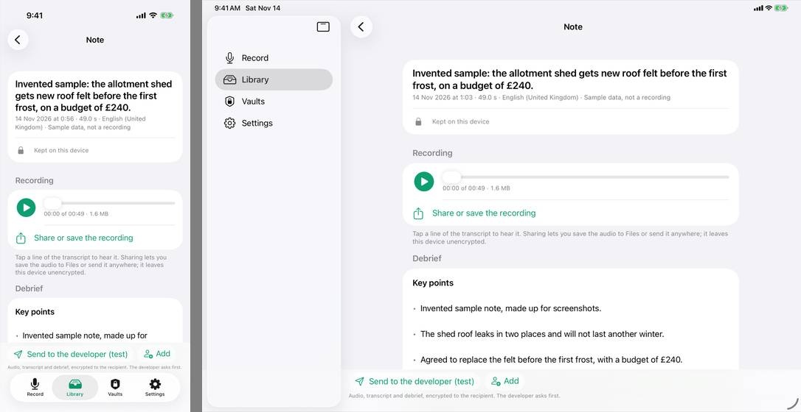
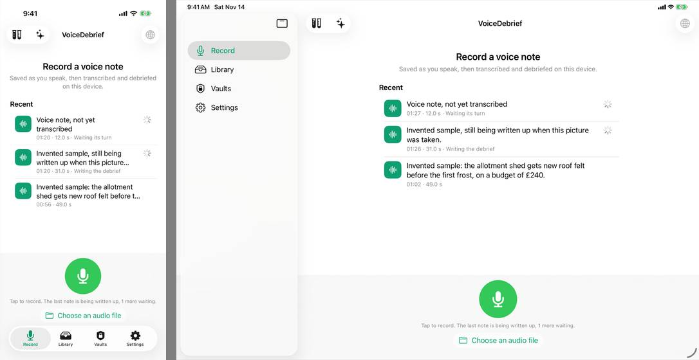
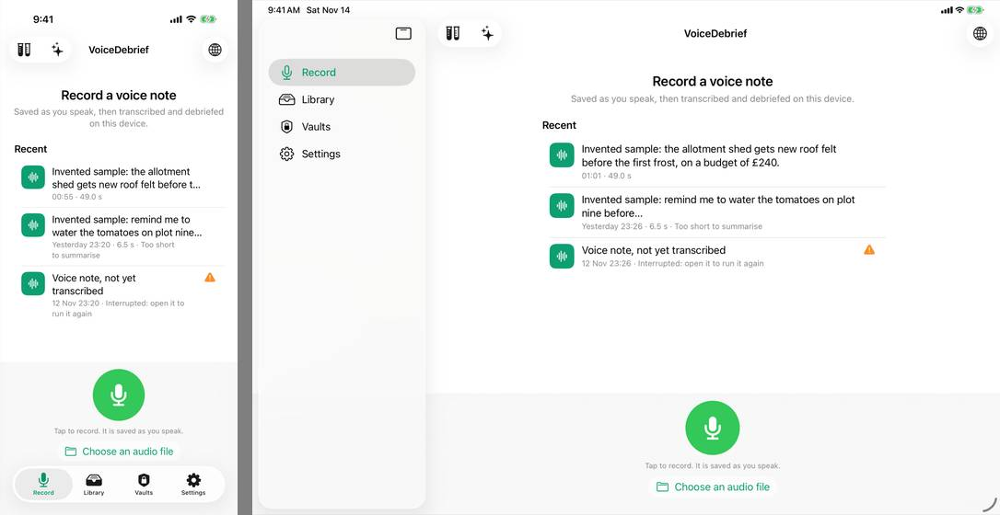
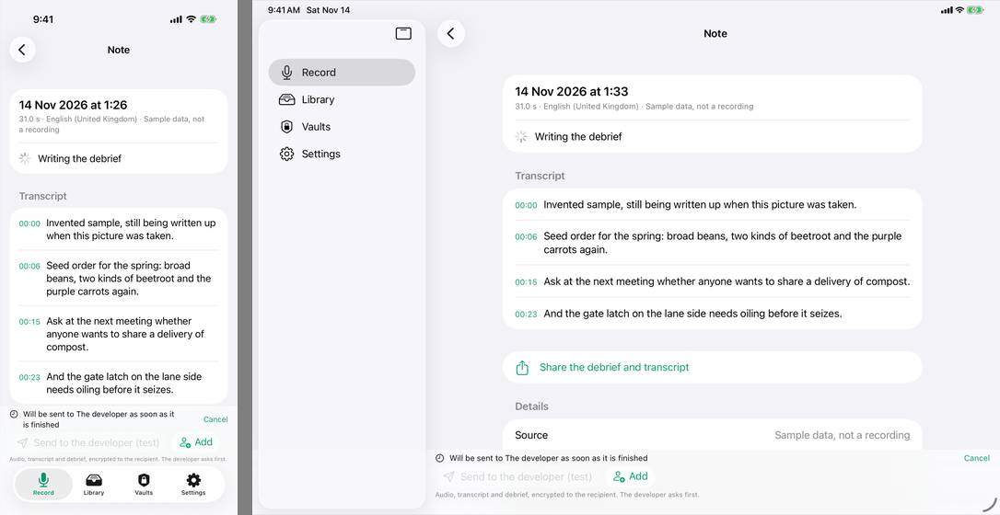
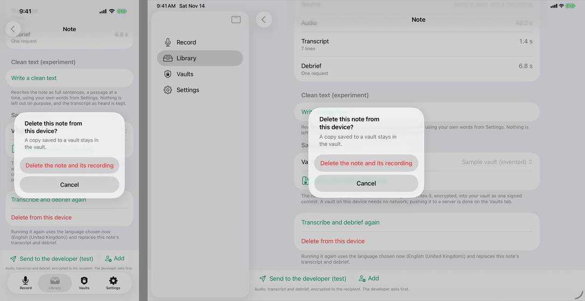
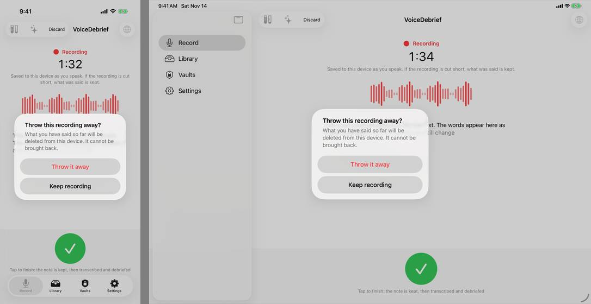
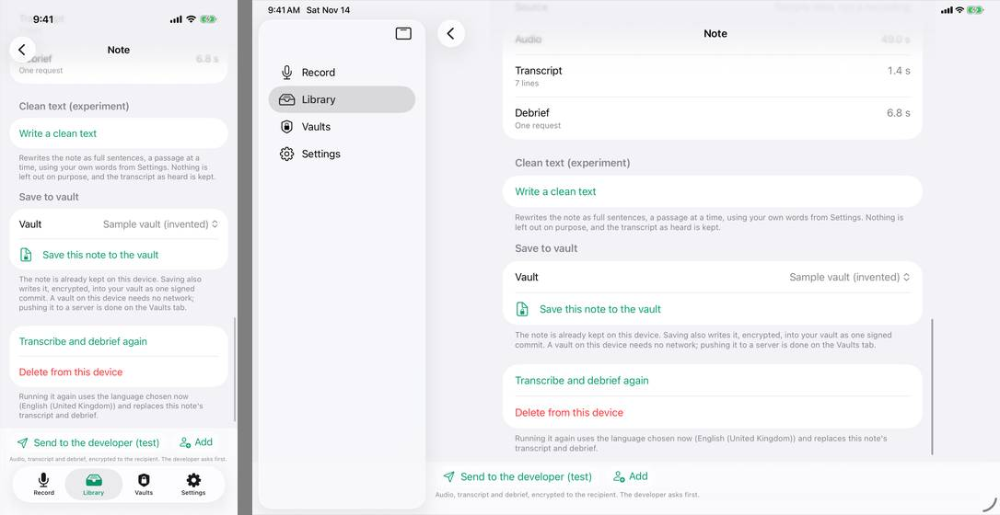
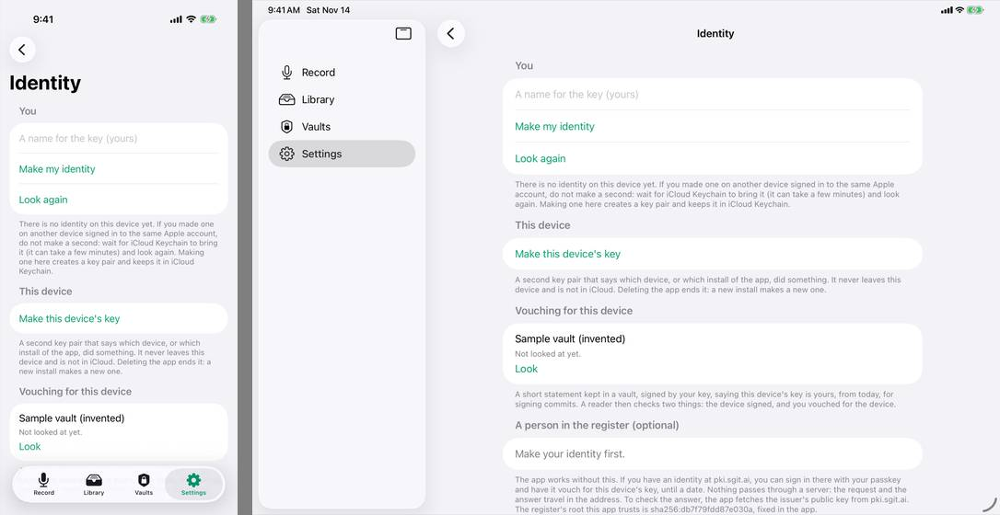

# What changed in v0.1.29

Released 14 November 2026. Every push to the repository's `dev` branch is a release; this page was written by CI from the notes that came with it. [Every version](../index.md) · [What is built](../../built/index.md)

A version badge at the top of the record and library screens, beside the balance, opens this version's own page of what changed. CI now writes that page for every release from the notes headed `next`.

After review round 2: a recording can be shared or saved to Files from its note (039); deleting a note, throwing away a recording and sending to the developer ask with an alert that always shows how to say no (040); Diagnostics no longer offers a lane link that nothing used (041); the balance reads "Test credit" and says recording never stops (032); the send bar is shorter; a time reads 00:03, not 0:03; a note never transcribed offers "Transcribe and debrief".

Review round 1, the rest of this session's findings: a recording can start while the last note is still being written up; notes wait their turn and say so (issue 030). States say what to do: an interrupted note says to open it and run it again, a note with no debrief says why, an untranscribed note is no longer titled Recording, and the record screen promises it saves as you speak before you start (issue 036).

After the first review by synthetic users (round 1): a note opens with its one sentence as the heading and the date beneath; the clean text experiment moves below the transcript; every note with audio has a player, and tapping a transcript line plays from there; the send bar appears only when there is something to send, lists your own recipients first, names the built-in one as the developer of this test build, and says what goes; lists hold a readable width on iPad; Recent says the day; a cut title ends with an ellipsis; the toolbar says the language rather than its code; one line, not 1 lines.

Pictures of every screen (issue 016). A debug build launched with `-VDSampleData` is given invented notes in a temporary folder, a vault book in memory with one invented vault in the same folder, and no network, never the real library or Keychain, and `-VDScreen` opens a named screen; none of it is compiled into a release build. A UI test target takes one screenshot per screen, and a new workflow, `screens.yml`, runs it on an iPhone and an iPad simulator in light and dark and keeps the PNGs, with a contact sheet per set, as an artifact named by commit. [Build, test and release](../../develop/index.md) says how to fetch them from a Linux container. Nothing a user sees has changed.

Identity (issues 005 and 018). `PKIKit`: the sgit key bundle in Swift (RSA-OAEP 4096 and ECDSA P-256, fingerprints, PKCS#8, keys under a passphrase, the `k1` key code, detached signatures, statements, the signed envelope), proven in a new workflow where `sgit pki` and pki.sgit.ai's own `keys.js` read what Swift makes and Swift reads what they make. In the app, under Settings, an Identity screen: a key pair that says who you are, kept in iCloud Keychain so it reaches your other devices; a second key that says which device, kept in the Secure Enclave where there is one and ended by deleting the app; a statement, signed by the first and kept in a vault, that vouches for the second; and, optionally, a delegation from an identity at pki.sgit.ai, with the answer pasted back in. In test: none of it has run on a device, and debriefs are not yet signed by the device key.

## Pictures

The screens that changed most, on an iPhone and an iPad, from the pictures CI took of this version (commit `9d61979`, which is this version's app). They are compared with the first set of pictures there was (13 November, commit `fb0c548`), because this page's notes reach back that far. Everything shown is invented sample data.

**A note opens with its one sentence as the heading, and has a player that shows the recording's length and size.**

**The record control stays live while earlier notes are written up, and says how many are waiting.**

**The record screen promises "Saved as you speak" before recording; Recent says the day; a row says what to do next. Two symbols in the top bar stand where the balance in pounds was.**

**A send pressed before a note is finished waits, and says so.**

**Deleting a note asks with an alert that shows Cancel.**

**Throwing a recording away asks first, with "Keep recording" beside it.**

**The end of a note: the clean text experiment is below the transcript, and the send bar is one quieter row that says what goes.**

**Identity, new under Settings, here with no identity made yet.**

Also changed: `note.transcript`, `note.interrupted`, `note.working`, `library`, `settings`, `credit`, `diagnostics`, `about`. The alert before sending is not pictured for this version: the test that taps the send control looked for its old name.
